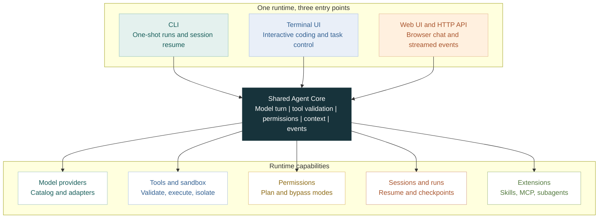

# Mini Agent Loop

[](https://www.npmjs.com/package/@krischen99999/mini-agent-loop)
[](https://nodejs.org/)

An extensible TypeScript runtime for building and running coding agents. Use
the same agent core from an interactive terminal, a one-shot CLI, or a local
Web UI, then extend it with your own models, tools, skills, and workflows.

## Recent Updates

Recent updates make long tasks easier to manage and recover:

- Background shell and subagent tasks can be inspected, continued, or stopped.
- Web and TUI runs checkpoint partial work and support budget-aware continuation.
- The TUI has richer task controls, alongside a ready-to-select model catalog.

See [Web UI](#web-ui), [Terminal TUI](#terminal-tui), and
[Configuration](#configuration) for details.

## What You Get

| Capability | What it does |
|---|---|
| Multiple ways to run | Ink terminal UI, resumable CLI, and local Web chat with an HTTP/NDJSON API. |
| Ready-to-select models | Browse the built-in multi-provider catalog from `/model`; configure a provider credential, then select an adapted model without defining its endpoint yourself. |
| Coding tools | Read, edit, write, search, and run commands in a workspace, with argument validation and workspace boundary checks. |
| Extensible workflows | Skills, explicitly configured MCP servers, Git operations, plans, and Plan-Act execution. |
| Long-running work | Persistent sessions, background tasks, subagents, checkpoints, and resumable runs. |
| Controlled execution | Plan mode for read-only analysis, explicit execution mode for writes, and configurable sandbox adapters. |

## Quick Start

Requires Node.js 22.19 or newer and an API key for a supported model provider.
For example, configure an OpenAI-compatible provider and install the CLI:

```bash
npm install --global @krischen99999/mini-agent-loop
export OPENAI_API_KEY=your-api-key
mini-agent-loop
```

To run one task directly instead of opening the interactive terminal:

```bash
mini-agent-loop-run "Summarize the project structure"
```

The interactive terminal starts in `plan` mode. Use `Shift+Tab` to switch to
`bypass` when you want to allow writes and other permitted actions. Provider
credentials are still required for live model calls.

For local development:

```bash
npm install
npm run tui
```

## How It Works

All front ends use the same agent loop, tool registry, permission manager, and
session store:



Tool arguments are validated before execution. Tool failures are returned to
the model as tool results, and each call receives a result before the next
model turn.

## Choose an Interface

| Interface | Start it | Best for |
|---|---|---|
| Terminal UI | `mini-agent-loop` or `npm run tui` | Interactive coding, model selection, sessions, and task control. |
| CLI | `mini-agent-loop-run "..."` or `npm start -- "..."` | One-shot jobs, scripting, and resuming sessions. |
| Web UI | `mini-agent-loop-web` or `npm run web:start` | Browser-based chat, workspace selection, and streamed tool activity. |

The Web UI can also be run in development with `npm run dev` for the API and
`npm run web:dev` for the frontend. See [Web UI](#web-ui) for build and launch
options.

## Models and Extensions

The built-in catalog includes adapted models from multiple providers. In the
TUI, use `/model` to search and select one. You only need to provide that
provider's API key; private gateways can be added through Web settings or
`MINI_AGENT_MODELS`. Model selection and custom gateway setup are described in
[Providers and models](#providers-and-models).

The runtime also supports Skills, explicitly configured MCP servers, local
tools, Git workflows, external repository analysis, vision preprocessing, and
document handling. See the [SDK guide](docs/build-agent-guide.md) to build a
specialized agent on top of the runtime.

## Documentation

- [Architecture](docs/architecture.md) — runtime flow, module map, and HTTP routes.
- [Security model](docs/security-model.md) — permission modes, sandboxing, and network access.
- [Web run policy](docs/web-run-policy.md) — budgets, checkpoints, and continue behavior.
- [Build an agent](docs/build-agent-guide.md) — customize tools, profiles, and delegation.
- [Project analysis](docs/project-analysis.md) — codebase structure and engineering notes.

**In this README:** [Recent Updates](#recent-updates) · [Quick Start](#quick-start) ·
[Interfaces](#choose-an-interface) ·
[Models](#models-and-extensions) · [Configuration](#configuration) · [CLI](#cli) ·
[Web UI](#web-ui) · [Integrations](#integrations) · [Terminal TUI](#terminal-tui) ·
[Development](#development)

## Configuration

The environment variable reference and provider-specific setup follow. Most
settings are optional; a live run needs a credential for the selected provider.

### Environment

| Variable | Required | Default |
|---|---|---|
| `OPENAI_API_KEY` | yes\* | — |
| `DEEPSEEK_API_KEY` | yes\* (DeepSeek alt) | — |
| `AGNES_API_KEY` | no | — |
| `GEMINI_API_KEY` | no | — |
| `DASHSCOPE_API_KEY` | no | — |
| `ZHIPU_API_KEY` | no | — |
| `MOONSHOT_API_KEY` | no | — |
| `XAI_API_KEY` | no | — |
| `MISTRAL_API_KEY` | no | — |
| `GROQ_API_KEY` | no | — |
| `OPENROUTER_API_KEY` | no | — |
| `TOKENROUTER_API_KEY` | no | — |
| `ORCAROUTER_API_KEY` | no | — |
| `SILICONFLOW_API_KEY` | no | — |
| `COHERE_API_KEY` | no | — |
| `PERPLEXITY_API_KEY` | no | — |
| `STEPFUN_API_KEY` | no | — |
| `OPENAI_BASE_URL` | no | OpenAI or DeepSeek auto |
| `OPENAI_MODEL` | no | `gpt-4o-mini` / `deepseek-chat` |
| `MINI_AGENT_REQUEST_TIMEOUT_MS` | no | `120000` (total request; `0` disables) |
| `MINI_AGENT_FIRST_RESPONSE_TIMEOUT_MS` | no | same as request timeout |
| `MINI_AGENT_STREAM_IDLE_TIMEOUT_MS` | no | `60000` after stream starts |
| `MINI_AGENT_MODELS` | no | — |

| `VISION_API_KEY` | no\* | — |
| `VISION_BASE_URL` | no\* | — |
| `VISION_MODEL` | no\* | — |
| `VISION_PROVIDER` | no | `openai-compatible` / `zhipu` |
| `ZHIPU_API_KEY` | no\* | — |
| `VISION_RETRIES` | no | `1` |
| `VISION_RETRY_DELAY_MS` | no | `1000` |
| `VISION_FALLBACK_MODEL` | no | — |
| `EXTERNAL_CODEBASE_ENABLED` | no | `1` |
| `EXTERNAL_CODEBASE_FETCH_TIMEOUT_MS` | no | `60000` |
| `EXTERNAL_CODEBASE_MAX_FILE_BYTES` | no | `262144` |
| `EXTERNAL_CODEBASE_MAX_RESULT_BYTES` | no | `102400` |
| `EXTERNAL_CODEBASE_MAX_CACHE_BYTES` | no | `1073741824` |
| `EXTERNAL_CODEBASE_CACHE_TTL_HOURS` | no | `24` |
| `DEEPWIKI_ENABLED` | no | `0` |
| `DEEPWIKI_TIMEOUT_MS` | no | `30000` |
| `DEEPWIKI_MAX_RESULT_BYTES` | no | `102400` |
| `MINI_AGENT_MCP_CONFIG` | no | — |
| `MINI_AGENT_PERMISSION_MODE` | no | `plan` (or `bypass`) |
| `MINI_AGENT_SUBAGENT` | no | `1` in CLI/server, TUI always on |
| `MINI_AGENT_SEARCH_ORCHESTRATION` | no | `0`; set `1` to expose the `search_orchestrate` tool |
| `MINI_AGENT_BG_TASKS` | no | `1`; set `0`/`false` to disable `bg_*` tools |
| `MINI_AGENT_BG_BACKEND` | no | `auto`; choose `auto`, `tmux`, or `process` |
| `MINI_AGENT_WEB_TOKEN_BUDGET` | no | unlimited per allocation |
| `MINI_AGENT_WEB_TOOL_CALL_BUDGET` | no | unlimited per allocation |
| `MINI_AGENT_WEB_WRITE_CALL_BUDGET` | no | unlimited per allocation |
| `MINI_AGENT_WEB_DEADLINE_MS` | no | unlimited execution time per allocation |
| `MINI_AGENT_WEB_MAX_COMPACTIONS` | no | `8` |
| `MINI_AGENT_WEB_SAME_ACTION_LIMIT` | no | `3` repetitions |
| `MINI_AGENT_WEB_NO_PROGRESS_LIMIT` | no | `6` turns |
| `MINI_AGENT_WEB_EMERGENCY_ITERATION_CAP` | no | `2000` (safety fallback) |
| `MINI_AGENT_TUI_TOKEN_BUDGET` | no | unlimited per TUI run |
| `MINI_AGENT_TUI_TOOL_CALL_BUDGET` | no | unlimited per TUI run |
| `MINI_AGENT_TUI_WRITE_CALL_BUDGET` | no | unlimited per TUI run |
| `MINI_AGENT_TUI_DEADLINE_MS` | no | unlimited execution time per TUI run |
| `MINI_AGENT_TUI_MAX_COMPACTIONS` | no | `8` |
| `MINI_AGENT_TUI_SAME_ACTION_LIMIT` | no | `3` repetitions |
| `MINI_AGENT_TUI_NO_PROGRESS_LIMIT` | no | `6` turns |
| `MINI_AGENT_TUI_EMERGENCY_ITERATION_CAP` | no | `2000` (safety fallback) |
| `MINI_AGENT_GLOBAL_TOKEN_BUDGET` | no | unlimited; shared by parent and nested subagents |
| `MINI_AGENT_GLOBAL_CONCURRENCY_LIMIT` | no | unlimited; applies across overlapping batches |
| `MINI_AGENT_GLOBAL_SUBAGENT_CALL_BUDGET` | no | unlimited; shared by parent and nested subagents |
| `MINI_AGENT_AUTO_SUBAGENT` | no | enabled by default; set `0`/`false`/`off` to disable |
| `MINI_AGENT_AUTO_SUBAGENT_MIN_SCORE` | no | `2` |
| `MINI_AGENT_AUTO_SUBAGENT_PROFILE` | no | auto (`researcher`/`coder`/`reviewer`) |
| `MINI_AGENT_AUTO_SUBAGENT_MODEL` | no | parent model |
| `MINI_AGENT_AUTO_SUBAGENT_MAX_TURNS` | no | profile/default |
| `MINI_AGENT_AUTO_SUBAGENT_ALLOW_WRITES` | no | disabled; automatic preflight stays read-only |
| `MINI_AGENT_SUBAGENT_AWAIT_BUDGET_MS` | no | `600000`; foreground sub-agents continue in background after this wait budget (`0` disables auto-backgrounding) |

\* Configure a key for the provider selected for a live model call. The model
picker can show catalog entries before their provider key is set. Vision
variables are optional unless a separate vision model is being configured.

Timeouts can also be configured **per model** via the model catalog
(`MINI_AGENT_MODELS` entries or built-in catalog entries), persisted profiles,
or `switchLlmModel`. Resolution order: explicit config override → model
catalog value → env var → default. See [Per-model timeouts](#per-model-timeouts).

### Request timeout recovery

LLM requests use three deadlines. The first-response deadline covers waiting for
the provider to start responding. The stream-idle deadline resets whenever a
stream chunk arrives, including reasoning output. The total request deadline
limits the entire request regardless of stream activity.

If a request times out before producing answer text, the main agent retries it
once. A timeout after partial answer text is preserved in conversation history
and is not replayed automatically. Nested sub-agent timeouts return any
recovered partial text to the parent as an error result, allowing the parent to
choose whether to retry or simplify the task.

### Web task policy and recovery

Web tasks use `AgentRunPolicy` by default. Token and time budgets, tool and write
call budgets, context compactions, and stalled-action detection determine when
execution pauses. The default `emergencyIterationCap: 2000` is a final safety
fallback, rather than the normal task budget. Token, time, tool and write budgets
are unlimited until configured; compactions default to 8, repeated actions to 3
repetitions, and turns without progress to 6.

Set `AgentServerOptions.runPolicy` or `MINI_AGENT_WEB_*` environment variables
to configure limits. Programmatic fields override environment values, which
override defaults. Values must be positive safe integers; invalid settings fail
initialization. Budgets are checked at safe turn boundaries, so an in-flight
request or tool batch can exceed a limit before pausing.

A policy pause saves complete partial history and usage, then emits one
`run_stopped` event with `budget_exhausted`, `safety_cap_reached`,
`context_exhausted`, or `stalled`. The Web UI displays the pause details and
consumption. Refreshing or restarting preserves `runState`, including allocation
usage and cumulative session usage.

While a Web task runs, one Codex-inspired activity row shows the current work,
elapsed time and a Stop control. Its title waits 600 ms, then sweeps a brightness
highlight for one second every four seconds. Changing activity restarts the
sweep while preserving the turn's elapsed time. The view follows reduced-motion
preferences. Source attribution and the upstream Apache-2.0 license are included
in `apps/web/THIRD_PARTY_NOTICES.md` and `apps/web/public/licenses/openai-codex/`.

The Continue button allocates a new default budget from the saved checkpoint.
`POST /api/sessions/:id/continue` also accepts new limits such as
`{ "tokenBudget": 50000, "deadlineMs": 300000 }`, or
`{ "budgetMode": "remaining" }` to reuse the saved allocation. Downtime is
excluded from execution time. Exhausted remaining budgets pause immediately.

The core loop runs until the assistant completes, the caller cancels, or a run
policy emits a stop event. There is no default 80-turn stop. CLI runs detect
repeated actions and sustained no-progress from tool events; TUI and Web also
apply their configured budgets and emergency safety caps. Explicit `maxTurns`
or `MINI_AGENT_MAX_TURNS` remains available as a compatibility safety cap.
See [Web policy and API events](docs/web-run-policy.md) for Web configuration,
checkpoint fields and request examples.

### Automatic subagent preflight

CLI, TUI, and the HTTP server now enable a deterministic code-level preflight by
default. The loop scores the first user request with explainable signals
(multi-step language, code/workspace context, write/review intent, deep scope,
web research, and explicit “delegate/subagent” wording). When the score reaches
`MINI_AGENT_AUTO_SUBAGENT_MIN_SCORE` (default `2`), it runs **one** subagent
before the parent model call and injects the result into parent context.

Profile selection is automatic unless you override it:

- write/implement/refactor → `researcher` by default; `coder` requires `MINI_AGENT_AUTO_SUBAGENT_ALLOW_WRITES=1`
- pure review/audit → `reviewer`
- otherwise → `researcher`

Simple single-step prompts (for example “读一下 package.json”) are intentionally
not delegated. When a request is delegated, the parent also enters **coordinator
mode**: it gets a stronger orchestrator prompt and may only make a small number
of direct exploration tool calls (`read`/`grep`/`find`/`ls`/`codebase_*`) before
further deep work must go through `subagent` / `subagent_batch`. The preflight
uses a focused child task (not the raw user prompt blob) and returns recoverable
partial progress when `maxTurns` is hit or no clean final summary is produced,
instead of hard-failing the whole delegation. The preflight option is not
propagated into nested subagents, so it does not recurse.

The built-in `researcher` and `reviewer` profiles are read-only and cannot use
workspace writes, process execution, network access, or external MCP data.

`web-researcher` is a separate profile for questions that need the web. It is
granted `web_search`, `fetch_content`, `get_search_content`, `source_check`
plus the read-only workspace tools, and nothing else. It is deliberately *not*
marked `readOnly`, because the subagent read-only gate also blocks network
access and would strip the web tools it exists to use; the tool allowlist is
the boundary instead.

Set `MINI_AGENT_SEARCH_ORCHESTRATION=1` to add the `search_orchestrate` tool.
It searches the web, asks a `web-researcher` planner to split the question into
a dependency-ordered task list, runs those tasks as subagents, then synthesizes
one answer. Each task may pin its own model — any catalog id or a model from a
provider saved in the Web settings page — so different subagents can run on
different third-party gateways. The workflow routes every subagent call through
the host's own subagent tool, so permissions, token budgets, preprocessors and
`/multi-agent` role bindings apply unchanged. The
parent and nested subagents can share a total token budget through
`MINI_AGENT_GLOBAL_TOKEN_BUDGET`; `MINI_AGENT_GLOBAL_CONCURRENCY_LIMIT` bounds
overlapping `subagent_batch` work. A value of `0` for the concurrency limit
means unlimited.

Subagent budgets are two-dimensional and can be combined: besides the token
budget above, the shared budget state (`GlobalBudgetState` on
`AgentRuntimeRef`, or the `agentBudgetCalls` option of the subagent tools and
`PipelineOrchestratorOptions`) carries a **call budget** — a hard cap on total
subagent launches across all depths, batches, and worker/reviewer dispatches.
Panels are validated **before launch**: a sync batch, an async batch
submission, or a pipeline wave that needs more calls than the remaining budget
is rejected whole, so no child starts at a loss (Grok Build `agent_budget`
semantics). The `dynamic` batch allocation strategy additionally re-splits the
remaining global token budget at the start of each dependency wave, so later
waves inherit savings from earlier ones. Provider rate-limit failures (429 /
"rate limit") surface as `rate_limit` subagent errors instead of generic
`api` errors.

When the inner loop stops at a bounded stop (safety cap or run budget), the
subagent recovers its partial tool progress and returns it to the parent with a
`[Partial]` marker instead of discarding the work.

Set `MINI_AGENT_AUTO_SUBAGENT=0` to skip preflight and leave delegation to the
model:

```bash
export MINI_AGENT_AUTO_SUBAGENT=0
```

### Providers and models

#### OpenAI

```bash
export OPENAI_API_KEY=sk-...
# optional:
# export OPENAI_BASE_URL=https://api.openai.com/v1
# export OPENAI_MODEL=gpt-4o-mini
# export OPENAI_MODEL=openai/gpt-6-astra
# Codex ChatGPT backend (same model id, qualified reference required):
# export OPENAI_MODEL=openai-codex/gpt-6-astra
```

#### DeepSeek (recommended for local development in CN)

DeepSeek’s chat API is OpenAI-compatible and supports tool calling via `deepseek-chat`.

```bash
# simplest: only DeepSeek key (base URL + model auto-fill)
export DEEPSEEK_API_KEY=sk-...

# or explicit OpenAI-compatible vars:
export OPENAI_API_KEY=sk-...          # your DeepSeek key
export OPENAI_BASE_URL=https://api.deepseek.com/v1
export OPENAI_MODEL=deepseek-chat
```

**Recommended for agent shells:** put the key in `mini-agent/.env` (gitignored). CLI loads it automatically:

```bash
# mini-agent/.env
DEEPSEEK_API_KEY=sk-...
```

Get a key at [https://platform.deepseek.com](https://platform.deepseek.com). The current default is `deepseek-v4-flash`.

#### Agnes AI

Agnes AI uses the OpenAI-compatible Chat Completions API. Its stable model is
`agnes-2.0-flash`; `agnes-2.5-flash` is a preview model and requires access on
the Agnes account.

```bash
export AGNES_API_KEY=your-agnes-api-key
export OPENAI_MODEL=agnes-ai/agnes-2.0-flash

# To use the preview model when your key has been enabled:
# export OPENAI_MODEL=agnes-ai/agnes-2.5-flash
```

Both models support streaming, tool calls, and image URLs. Their endpoint is
`https://apihub.agnes-ai.com/v1/chat/completions`; no base URL override is
needed. When `AGNES_API_KEY` is the only configured provider key, the default
selection is `agnes-2.0-flash`.

#### Moonshot AI (Kimi K3)

Kimi K3 is available through Moonshot's OpenAI-compatible regional endpoints
and uses the existing `MOONSHOT_API_KEY`:

```bash
export MOONSHOT_API_KEY=sk-...
export OPENAI_MODEL=moonshotai/kimi-k3       # international endpoint
# or: export OPENAI_MODEL=moonshotai-cn/kimi-k3  # China endpoint
```

In the TUI, use `/model moonshotai/kimi-k3` or
`/model moonshotai-cn/kimi-k3`. The qualified reference is required because
both regions expose the same `kimi-k3` model id.

#### TokenRouter (Kimi K3 Free)

TokenRouter exposes a fixed free Kimi K3 route through its OpenAI-compatible
Chat Completions endpoint:

```bash
export TOKENROUTER_API_KEY=tr_...
export OPENAI_MODEL=tokenrouter/kimi-k3-free
```

In the TUI, select it with `/model tokenrouter/kimi-k3-free`. The project sends
the fixed model id `kimi-k3-free` to
`https://api.tokenrouter.io/v1/chat/completions`.

#### OrcaRouter (Free Models)

OrcaRouter is an OpenAI-compatible AI gateway; the catalog registers its free
routes (see <https://www.orcarouter.ai/models?price=free>):

```bash
export ORCAROUTER_API_KEY=sk-orca-...
export OPENAI_MODEL=orcarouter/deepseek/deepseek-v4-flash-free
```

In the TUI, select one of the registered free routes:

```bash
/model orcarouter/deepseek/deepseek-v4-flash-free   # DeepSeek V4 Flash free (1M context)
/model orcarouter/tencent/hy3-free                  # Tencent Hy3 free (256K context)
/model orcarouter/z-ai/glm-5.3-flash-free           # GLM 5.3 Flash free (1M context, text + image)
/model orcarouter/orcarouter/free                  # OrcaRouter's free adaptive router
```

Requests go to `https://api.orcarouter.ai/v1/chat/completions`.

#### Built-in catalog and custom providers

The built-in catalog contains the generated multi-provider model definitions.
Run the TUI, then use `/model` to search all adapted models:

```bash
npm run tui

# examples inside the TUI
/model
/model deepseek/deepseek-v4.1-flash
/model openai/gpt-6.1-terra
/model openai/gpt-6-astra
/model openai-codex/gpt-6-astra
/model google/gemini-4-argon
/model anthropic/claude-sonnet-5.5
/model google/gemini-2.5-pro
/model openrouter/anthropic/claude-sonnet-4
# positional custom gateway: model, base URL, api key
/model xai/grok-3 https://api.sparkcode.top/v1 sk-...
# flag form still works for a custom OpenAI-compatible gateway
/model openai/gpt-4.1 --base-url https://llm.example/v1 --api-key-env COMPANY_LLM_KEY
# Claude 中转站: most gateways speak Chat Completions, so a custom URL
# drops native Anthropic Messages. Force Messages only when the gateway
# actually implements /v1/messages.
/model anthropic/claude-sonnet-4-6 https://api.sparkcode.top/v1 sk-...
/model anthropic/claude-sonnet-4-6 https://gw.example/anthropic/v1 sk-... --protocol anthropic
```

Models are shown even when their provider credential is not configured. Selecting
one does not persist the key; the provider validates credentials when the next
request is sent. `--api-key VALUE` is also supported for a temporary in-memory
override, but `--api-key-env ENV_NAME` is preferred.

For a new model or private OpenAI-compatible gateway, add it without changing
source code:

```bash
CUSTOM_LLM_KEY=sk-...
MINI_AGENT_MODELS='[{"provider":"company","id":"company-model-v1","baseUrl":"https://llm.example/v1","apiKeyEnv":"CUSTOM_LLM_KEY","input":["text"],"tools":true,"contextWindow":128000}]'
```

`MINI_AGENT_MODELS` is a JSON array. Each entry requires `provider`, `id`,
`baseUrl`, and `apiKeyEnv`; optional fields are `input`, `tools`,
`contextWindow`, and `api` (`"anthropic-messages"` keeps Claude on native
Messages even when `baseUrl` is a private gateway).

The Web UI can persist the same setup without editing environment variables.
Open **Settings → Models → Custom model API**, choose **Add provider**, and
enter the provider ID, base URL, API key, protocol, and one or more model IDs.
**Fetch models** reads the provider's `/models` endpoint and fills the model
list; models can also be entered manually. Supported protocols are OpenAI Chat
Completions, OpenAI Responses, and Anthropic Messages. The configuration is
stored in `MINI_AGENT_MODEL_CONFIG` (or `~/.mini-agent/models.json`) with
owner-only permissions; API keys are never returned by the Web API.
Use the service's API base URL, without `/chat/completions`, `/responses`, or
`/messages`. OpenAI protocols preserve the configured prefix (include `/v1`
when the service requires it). Anthropic accepts a base with or without a
trailing `/v1`.

For a custom reasoning model, check **Enable thinking** and choose the
**Default thinking level**. Common settings are filled in automatically;
DeepSeek URLs and model IDs use DeepSeek's thinking format. Change the current
level in the conversation's **Effort** menu.

**Advanced thinking settings** is optional. It preserves existing custom
mappings and lets unusual endpoints restrict their accepted levels or rename
an API value (for example, `max` → `ultra`). Chat Completions providers can
override the **Thinking format** or disable **Send reasoning effort** for
endpoints that accept only an on/off switch. Provider-wide overrides live under
**Advanced API settings**. The request preview uses the same serializer as
live Chat Completions requests.

The corresponding fields inside a `customProviders` entry are:

```json
{
  "compat": { "thinkingFormat": "deepseek", "supportsReasoningEffort": true },
  "models": [{
    "id": "my-reasoner",
    "reasoningEfforts": { "off": null, "high": "high", "max": "ultra" },
    "defaultThinkingLevel": "high"
  }]
}
```

This example assumes the gateway accepts DeepSeek-style thinking parameters
and `high`/`ultra` efforts. An explicit efforts object exposes only its declared
levels; omitted levels are unavailable. `off: null` uses the selected protocol's
Off behavior (for DeepSeek, `thinking: {type: "disabled"}`); a string provides
an explicit Off value for formats such as OpenAI or OpenRouter. Declare Off
only when the endpoint supports it. `reasoningEfforts: false` disables the
capability. Existing `reasoning: true/false` configurations remain supported.
`compat` fields shown here apply to Chat Completions; Responses and Anthropic
use their protocol adapters. Select **Effort** in the conversation's model menu
to change the current session. Choices persist across restarts. Updated custom
provider settings apply at the next operation, preserving a supported session
level and falling back to the model default when the old level was removed.

A persistent 中转站 for every Claude request can also be set with
`MINI_AGENT_RELAY`. Omit `protocol` (or set `"openai-compatible"`) for the
usual Chat Completions gateways; set `"protocol":"anthropic-messages"` only
when the relay implements Anthropic `/v1/messages`:

```bash
MINI_AGENT_RELAY='{"providers":["anthropic"],"baseUrl":"https://api.sparkcode.top/v1","apiKey":"sk-..."}'
```

#### Per-model timeouts

Slow deep-thinking models often need longer deadlines than fast chat models.
Instead of raising the global timeout for everyone, a model entry can carry its
own layered timeouts:

```bash
CUSTOM_LLM_KEY=sk-...
MINI_AGENT_MODELS='[{"provider":"company","id":"deep-thinker-v1","baseUrl":"https://llm.example/v1","apiKeyEnv":"CUSTOM_LLM_KEY","contextWindow":128000,"timeoutMs":600000,"firstResponseTimeoutMs":300000,"streamIdleTimeoutMs":180000}]'
```

- `timeoutMs` — total request deadline (default 120s; `0` disables)
- `firstResponseTimeoutMs` — time-to-first-chunk deadline (defaults to `timeoutMs`; `0` disables)
- `streamIdleTimeoutMs` — max gap between stream chunks (default 60s; `0` disables)

Resolution order: explicit config override → model catalog value →
`MINI_AGENT_*_TIMEOUT_MS` env var → default. Switching models with `/model`
automatically adopts the target model's catalog timeouts and drops stale ones.
The same fields may be persisted on a profile in `~/.mini-agent/models.json`
(see below).

#### Vision preprocessing for DeepSeek

DeepSeek remains the text reasoning model. A separate OpenAI-compatible vision
model converts images into structured observations before DeepSeek is called.
The adapter is provider-neutral. The vision variables are optional; for the
generic provider, set
`VISION_API_KEY`, `VISION_BASE_URL`, and `VISION_MODEL` together. When
configured, images sent to a text-only main model are analyzed before the main
model call. Without them, the existing `IMAGE_POLICY` degradation applies.
For example, a DashScope-compatible Qwen VL configuration can be placed in
`.env`:

```bash
DEEPSEEK_API_KEY=sk-...
OPENAI_MODEL=deepseek-chat

VISION_API_KEY=sk-...
VISION_BASE_URL=https://dashscope.aliyuncs.com/compatible-mode/v1
VISION_MODEL=qwen-vl-plus
```

For Zhipu's OpenAI-compatible vision endpoint, the preset can be used with
only the provider key; override `VISION_MODEL` when your account exposes a
different current GLM vision model:

```bash
DEEPSEEK_API_KEY=sk-...
OPENAI_MODEL=deepseek-chat
VISION_PROVIDER=zhipu
ZHIPU_API_KEY=...
# optional:
# VISION_MODEL=glm-4v-plus
```

```text
user/tool images
  -> VisionPreprocessor (all new images in one batch)
  -> structured vision analysis
  -> DeepSeek (text only)
```

If the vision request fails, times out after 60 seconds, or returns empty
content, the turn fails before DeepSeek is called. Temporary 429/5xx/network
errors are retried once by default. Set `VISION_FALLBACK_MODEL` to try another
vision model after those retries; fallback is opt-in to avoid unexpected API
usage.

## CLI

Run these commands from the repository root, where `package.json` is located.

```bash
# offline unit tests (no key)
npm test
npm run typecheck

# live agent (needs API key in .env or export)
npm start -- "Summarize the project structure"
npm start -- "Describe this image" --image ./shot.png

# resume the most recent session in the current workspace
npm start -- --continue "Continue the previous task"

# resume a specific session, or list sessions when no id is supplied
npm start -- --resume <session-id> "Continue this session"
npm start -- --resume

# resume into a new fork without changing the source session
npm start -- --resume <session-id> --fork-session "Start a new branch here"

# equivalent without npm script:
npx tsx src/cli.ts "读取 package.json 并总结项目名"
```

Do **not** write `npm start ` with a trailing space in the script name, and keep the `--` before the prompt so npm forwards args to the CLI.

Events (`assistant` / `tool_start` / `tool_end` / `done`) log to stderr; final assistant text prints to stdout.

## Web UI

The GUI keeps model credentials and file tools in a local Node server. The
browser receives sanitized text/tool events and never receives API keys or
image base64 from the agent history.

```bash
# development: API on 127.0.0.1:3001, GUI on 127.0.0.1:5173
npm run dev

# production build, then serve GUI + API together on 127.0.0.1:3001
npm run build
npm run serve

# packaged Web entry: starts the local API and opens the bundled Web UI
npm run build:package
node dist/web-launcher.js

# after installing the package globally, the same entry is:
mini-agent-loop-web --workspace /absolute/path/to/project
```

The Web launcher is an additional entry point. It does not replace the
existing `mini-agent-loop` Ink client or `mini-agent-loop-run` one-shot CLI.
Use `--no-open` to keep the browser closed, or `--port <number>` to choose a
different local port. `--workspace <path>` sets the default project directory
for new sessions; individual sessions can still use the Web workspace picker.

Optional server environment:

```bash
PORT=3001
AGENT_WORKSPACE=/absolute/path/to/workspace
```

The chat supports multi-turn sessions, workspace file-tree path references,
up to five images per message, file selection or clipboard image paste, tool
activity events, Markdown rendering, and new-session reset. Selecting a file in
the sidebar only adds a path reference; the agent still uses the `read` tool to
load contents. Sessions are persisted under `AGENT_DATA_DIR` (workspace-scoped,
with a 30-day default TTL) and are restored when the server restarts.

The CLI, TUI, and Web server expose `bg_start`, `bg_status`, `bg_logs`,
`bg_send`, `bg_wait`, `bg_kill`, `bg_snapshot`, `bg_replay`,
`bg_search_logs`, `bg_kill_by_tag`, and `bg_status_by_tag` for
persistent background tasks. The default `auto` backend uses tmux when
installed and otherwise runs a detached Node process. Process-backed
tasks support logs, status, waiting, timeouts, and cancellation;
interactive `bg_send` requires tmux. The Web server also provides
workspace-scoped `/api/background-tasks` control routes and initializes
the suite on the first background-task request. Set
`MINI_AGENT_BG_TASKS=0` to disable it.

When background tasks are enabled and Bash is not using an isolated sandbox,
the `bash` tool also accepts `is_background: true` to start a command and
immediately return its task ID.
The resulting task is managed by the same `bg_status`, `bg_logs`, `bg_wait`,
and `bg_kill` tools. Omitting the flag starts the command in the foreground.
Foreground Bash commands that exceed the default 15-second wait budget are
automatically returned as background tasks. In the TUI, `Ctrl+G` promotes the
currently waiting command while leaving the current turn running; submitting a
message with Enter during that wait promotes the command and sends the message
immediately. Enter also sends immediately while waiting on `bg_wait` or a
subagent when no earlier message is queued. During other busy phases, Enter
queues a message; pressing Enter again with an empty input sends the next queued
message, and `Ctrl+Enter` cancels the current turn and sends the draft. Set
`MINI_AGENT_BG_FOREGROUND_MS` to change the wait budget (`0` waits until the
Bash `timeout` value). Background completion displays the final 4 kB of
output in the TUI and sends an unconsumed completion result to the agent; a
task already being awaited by a tool does not trigger a duplicate agent turn.

Sub-agent calls in TUI, the CLI, and persistent server sessions start in the background
by default and return a `sub_...` task ID. CLI tasks run in detached worker
processes, so they continue after the one-shot parent command exits. Use
`subagent_tasks` to list tasks, `subagent_output` to read status and output,
`subagent_wait` to wait for one or more tasks, `subagent_send` to queue an
additional instruction for the next model turn, and `subagent_kill` to cancel
running work. In the CLI, `subagent_batch` also runs in a detached worker by
default and returns a `jobId`; use its `status`, `result`, and `wait` actions to
manage the persisted DAG. Specify `mode: "sync"` when the caller needs batch
results in the same tool call. Set
`runInBackground: false` when a caller needs the result in the same tool call.
A foreground call that exceeds `MINI_AGENT_SUBAGENT_AWAIT_BUDGET_MS` continues
in the background instead of blocking its parent indefinitely. Completed
transcripts are saved under `.subagent-tasks/` and can be continued with
`resumeFrom` plus a new task prompt. If a worker exits unexpectedly, its task
is recorded as interrupted and restarted from its saved checkpoint on the next
CLI invocation for that session. Detached batch jobs are also resumed when
their owning session is opened again.
Running `mini-agent-loop-run --continue` or `--resume <session-id>` delivers an
unconsumed completion as an untrusted system reminder in the next turn.

An unconsumed background sub-agent completion wakes its owning TUI or HTTP
session once. The server queues a new session job after the current session
operation releases its execution lease. The wake is suppressed when the result
was read or waited for, the task was killed, `MINI_AGENT_AUTO_WAKE` is disabled,
or a Plan-Act execution is active. Set `MINI_AGENT_AUTO_WAKE=0` to disable
completion wakeups.

The HTTP API accepts `workspaceId` or `sessionId` to select a workspace. Its
routes are `GET/POST /api/background-tasks`,
`GET /api/background-tasks/:taskId`,
`GET /api/background-tasks/:taskId/logs?offset=0&limitBytes=16384`,
`POST /api/background-tasks/wait` with `{ "taskIds": ["bg_..."] }`,
`POST /api/background-tasks/:taskId/input` with `{ "text": "...", "enter": true }`,
and `POST /api/background-tasks/:taskId/kill` with `{ "force": true }`.
Start a task with `{ "sessionId": "<session-id>", "command": "npm test", "name": "tests", "cwd": "." }`;
the response is `202` with the new task summary. Mutating routes require a
session so the server can apply that session's permission mode. A task working
directory is checked against its selected workspace before it is accepted.

The core tool registry follows Pi Agent's seven-tool vocabulary:

- `read`: read text files and supported images.
- `bash`: execute commands in the workspace with timeout and cancellation.
- `edit`: apply exact unique replacements using `path` and `edits[]`.
- `write`: create or overwrite UTF-8 text files.
- `grep`: regex/literal content search with glob, case, and context options.
- `find`: find files by glob pattern.
- `ls`: list directory contents, including dotfiles.

The default active set is Pi's `read`, `bash`, `edit`, and `write`. CLI users
can opt into the read-only tools with `--tools grep,find,ls`, or remove tools
with `--exclude-tools bash`. SDK/server callers can pass the equivalent
selection to `createDefaultTools`.

External public GitHub analysis adds four tools by default:

- `codebase_open`: create a read-only handle for `owner/repo` or a GitHub URL.
- `codebase_search`: search the pinned Git revision with file and line evidence.
- `codebase_read`: read bounded source ranges from the pinned revision.
- `codebase_explain`: optional DeepWiki semantic structure, contents, and question operations.

External repositories are shallow bare clones under `~/.mini-agent/codebases`.
The agent never checks them out or executes their code. Git authentication,
global Git configuration, hooks, submodules, and LFS smudge are disabled for
this path. Set `EXTERNAL_CODEBASE_ENABLED=0` to remove these tools.
DeepWiki is disabled by default. Set `DEEPWIKI_ENABLED=1` to enable the fixed
official endpoint `https://mcp.deepwiki.com/mcp`; only the public repository
name and requested question are sent to it.

All tools still use relative paths and reject paths that escape the configured
workspace or resolve through an outside symlink. `.git` and `node_modules`
remain protected by the workspace sandbox.

## Integrations

### Shell execution on Windows

The tool keeps the name `bash`, but local Windows execution discovers PowerShell
7 (`pwsh.exe`) first, then Windows PowerShell (`powershell.exe`), then falls back
to `ComSpec` / `cmd.exe`. Discovery checks absolute PATH entries and standard
installation directories. PowerShell runs without profiles and non-interactively.
The tool description advertises the selected shell syntax; commands are not
translated between bash, PowerShell, and cmd. Unix execution remains `bash -lc`.

With sandbox type `auto`, Windows uses the Node process runner rather than
implicitly selecting Docker. `MINI_AGENT_SANDBOX_TYPE=docker` explicitly selects
the container runner, which still executes Linux bash and requires a working
Docker runtime and sandbox image. Other platforms retain their existing auto
selection order. A `required` sandbox configuration never falls back to Node:
Windows auto mode fails with guidance to explicitly configure Docker.

**The Node runner is not an OS security sandbox.** It does not enforce arbitrary
shell filesystem confinement or reliable network isolation. Permission checks
remain in effect; use local execution only for trusted commands. Native Windows
ACL sandboxing and interactive PTY sessions are not implemented by this change.

### MCP tools

The agent can load tools from explicitly configured MCP servers over `stdio`
or Streamable HTTP (`"transport": "http"`, with `url` and optional `headers`).
It does not auto-discover project configuration because an MCP stdio entry can
execute a local command. Set `MINI_AGENT_MCP_CONFIG` to a file you trust:

```json
{
  "mcpServers": {
    "local-search": {
      "transport": "stdio",
      "command": "node",
      "args": ["/absolute/path/to/server.mjs"],
      "env": {
        "TOKEN": "${MCP_SEARCH_TOKEN}"
      },
      "required": false,
      "includeTools": ["search"],
      "timeoutMs": 30000,
      "reconnect": true,
      "reconnectDelayMs": 1000,
      "maxReconnectDelayMs": 30000,
      "maxTools": 16,
      "maxSchemaBytes": 262144,
      "maxResultBytes": 1048576
    }
  }
}
```

Relative `cwd` values are resolved from the config file directory. `${NAME}`
environment references must exist when the agent starts. Optional servers enter
a reconnecting or error state when unavailable; a failed server with
`required: true` still prevents initial startup. `excludeTools`, `enabled`, and
per-server limits are also supported.
Connected servers that exit are removed from the active tool registry and
reconnected with bounded exponential backoff by default. Set `reconnect` to
`false` to disable this, or tune `reconnectDelayMs` and
`maxReconnectDelayMs`.

```bash
export MINI_AGENT_MCP_CONFIG=/absolute/path/to/mcp.json

# The one-shot CLI registers configured MCP tools on every invocation.
# Calls stay denied until this process opts in, either for every server or
# for one server / one tool. MINI_AGENT_MCP_ALLOW accepts the same entries.
npm start -- --allow-mcp-tools "使用已配置的远端工具查询数据"
npm start -- --allow-mcp search --allow-mcp docs/read "只允许这些远端调用"
```

All clients use the same `PermissionManager` policy. In `bypass`, configured
MCP tools run without an approval prompt. In `plan`, writes, dangerous shell,
and MCP calls are hard-denied because plan mode is analysis-only (remote tool
metadata cannot establish local read-only behavior). `/api/config` returns
only sanitized server status metadata, never commands, arguments, or
environment values.
When a server advertises and sends `tools/list_changed`, the agent refreshes
the complete paginated catalog. The next inner model turn receives the updated
tool set without restarting the process. Changes to the MCP JSON configuration
itself still require a restart.

User-configured servers use stdio or Streamable HTTP. DeepWiki internally uses
the fixed official Streamable HTTP endpoint. Connected servers also expose
`mcp_prompts` and `mcp_resource`, which list and read remote prompts and
resources as untrusted data. OAuth, sampling, elicitation, and task-required
tools remain out of scope. The TUI status row shows a compact connection
summary such as `MCP 2 ready` when servers are configured.

### HTTP API

The local server exposes these session and workflow routes:

```text
GET    /api/health
GET    /api/config
GET    /api/workspace/list?path=   lazy directory listing (workspace sandbox)
POST   /api/sessions
GET    /api/sessions/:id
GET    /api/sessions/:id/permission-mode
PUT    /api/sessions/:id/permission-mode  { mode: plan|bypass }
POST   /api/sessions/:id/permissions/:requestId  { decision: allow|deny }
DELETE /api/sessions/:id
POST   /api/sessions/:id/messages  multipart(prompt, referencedPaths, images) -> NDJSON stream
POST   /api/sessions/:id/fork     { messageId? | messageIndex? } -> new session
POST   /api/sessions/:id/rewind   { messageId? | messageIndex } -> truncated session
GET    /api/sessions/tree         session fork tree
```

Session detail messages include stable `id` values. `messageId` retains the
selected message and everything before it; `messageIndex` remains supported
for clients using the original count-based API. Truncation never leaves a
partial assistant tool-call block.

#### Session plan workflow

Plans are stored under `dataDir/session-plans/:id`.

```text
GET    /api/sessions/:id/plan
POST   /api/sessions/:id/plan                 { prompt, plan, autoApprove? }
POST   /api/sessions/:id/plan/approve         { by? }
POST   /api/sessions/:id/plan/reject
POST   /api/sessions/:id/plan/edit            { plan }
POST   /api/sessions/:id/plan/archive
GET    /api/sessions/:id/plan/history
POST   /api/sessions/:id/plan/generate        { prompt } -> { plan, answer }
POST   /api/sessions/:id/plan/execute         { yes?, force? } -> NDJSON stream
POST   /api/sessions/:id/plan/retry           { yes?, force? } -> NDJSON stream
```

Plan execute/retry streams the usual agent NDJSON events plus:
`plan_execution_started`, `plan_updated`, and `plan_execution_finished`.
Session detail (`GET /api/sessions/:id`) includes `planStatus` when a plan exists.

## Terminal TUI

The Ink terminal client uses the same Agent Core and tool registry as the CLI
and Web GUI. It supports streaming output, tool activity, file completion, and
the local `/model` selector. Permission modes are cycled with `Shift+Tab`:

| Mode | Executes tools? | Asks user? | Typical use |
| --- | --- | --- | --- |
| `plan` (default) | Local read-only only; writes/dangerous shell/MCP hard-denied | No approval path | Risk analysis / planning |
| `bypass` | Yes, including MCP | Never | Trusted local runs / CI |

The former `approval` permission mode was removed. It must not be silently
mapped to `bypass`; use `plan` for safe analysis or the plan workflow for
reviewing a complete plan before execution.

```bash
npm run tui
```

`npm run tui` and the installed `mini-agent-loop` / `mini-agent-loop-tui`
commands run the same **React + Ink** terminal UI (`src/tui/ink-main.tsx`,
packaged as `dist/tui.js`). It uses a Claude Code-inspired layout but is this
project's own client, not Anthropic's `claude` CLI. There is no pi-tui, legacy,
or standalone ANSI terminal entrypoint and no `--renderer` switch. The Ink
client uses the shared Agent Core, reducer, tool registry, permissions, and
session persistence.

Use `/model`, `/profiles`, `/sessions`, `/resume [id]` (or `resume [id]`), `/clear`, `/quit`, or `Ctrl+C`
inside the TUI. Typing `/sessions` or `/resume` opens the saved-session
picker with IDs, message counts, and prompt previews. Enter on `/resume` restores
the selected session; `/resume <id-prefix>` selects a specific one directly.
Use `/mcp` to inspect configured MCP server states and `/mcp <server>` to list
that server's available tools.
Startup flags mirror the CLI: `npm run tui -- --continue`,
`npm run tui -- --resume <id>`, and `npm run tui -- --resume <id> --fork-session`.
`/model` also accepts `--base-url`, `--api-key-env`, and temporary `--api-key`
overrides. Sessions are persisted under the shared `AGENT_DATA_DIR` root and
restore history, tool results, Todo/Plan state, permission mode, and model
settings on the next start. The Ink interface follows the Claude Code-style
conversation layout.
TUI runs use `AgentRunPolicy` by default. Token, time, tool and write budgets,
context compaction, repeated-action detection, and no-progress detection can
pause a run while preserving its partial history. The task summary reports the
pause reason and usage; `/continue` resumes the saved task with a fresh policy
allocation without adding a synthetic user message. Set the `MINI_AGENT_TUI_*`
variables to configure the defaults. `MINI_AGENT_MAX_TURNS` or an explicit
`maxTurns` opts a caller into the legacy hard-stop path for compatibility.
TUI supports plan workflow slash commands: `/plan`, `/plan-show`, `/plan-approve`,
`/plan-reject`, `/plan-run`, `/plan-retry`, `/plan-history`, `/plan-archive`.
Terminal input follows the Claude Code-style priority order: `Tab`/`↑↓` first
operate the active command, argument, file, model, or profile picker; when no
picker is open, `↑`/`↓` recall the last 200 submitted prompts (multiline drafts
keep vertical cursor movement). `Alt+↑`/`Alt+↓` moves focus between reasoning
messages, and `Alt+T` expands or collapses the focused reasoning block.
`/tasks`, `/copy`, `/skills`, and `/resume` provide argument completion;
`/resume` loads session IDs from the shared session store.

`skills/adapt-foreign-session` continues a local Claude Code or Codex CLI chat
as a short handoff. Activate it with `/skill adapt-foreign-session` or
`MINI_AGENT_SKILLS=adapt-foreign-session`, then ask to continue that session.
The same reader is available without the skill:

```bash
npm start -- --resume-claude
npm start -- --resume-claude <session-id-or-title> "continue the imported work"
npm start -- --resume-codex latest
```

In the TUI, `/resume-claude [ref]` and `/resume-codex [ref]` import the
transcript into a new local session. The Web sidebar has the same action.
`/resume` still opens only this project's saved sessions. A repeated import of
the same source session reopens the existing local session. The reader checks
`~/.claude` or `~/.codex` on the host; a Docker sandbox that cannot see that
home directory has no transcripts to import.
CLI one-shot runs accept `--mode plan|bypass` (default `plan`). The former
`approval` permission mode is no longer supported; migrate read-only runs to
`plan`, trusted unattended execution to `bypass`, or use the plan workflow
below for human review before writes. `--plan` forces plan mode;
`--plan-execute` loads a saved plan and runs it in `bypass`. Use
`--mode=bypass` for unattended execution that may write files.

### Plan workflow

Plans are stored under `.mini-agent/plan/` (current + history archive).

| Flag | Action |
|------|--------|
| `--plan` | Generate a plan only (no writes) |
| `--plan --yes` | Generate and auto-approve |
| `--plan-show` | Show current plan (metadata + preview) |
| `--plan-approve` / `--plan-reject` | Approve or reject current plan |
| `--plan-execute` / `--plan-retry` | Execute / retry a saved plan |
| `--plan-force` | Force execution even if rejected/pending |
| `--plan-edit` | Open `$EDITOR` / `$VISUAL` / `vi` on current plan markdown |
| `--plan-set-file <path>` | Replace current plan markdown from a file |
| `--plan-history` | List archived plans |
| `--plan-archive` | Snapshot current plan into history |

After execution, the workflow runs a **file audit** (git status/diff when available):
planned vs changed files, unplanned edits, and inferred per-step status
(`todo` / `doing` / `done` / `failed`). The audit is stored on the plan document
and printed by CLI / TUI / server events.

Successful `--plan-execute` runs auto-archive a completed copy to
`.mini-agent/plan/history/<id>.json` (current plan is left in place).

Thinking strength is configured independently from model selection. In either
TUI, press `Ctrl+R` to cycle through all levels supported by the active model;
the status bar shows the new level immediately. Use `Shift+Up` / `Shift+Down`
(or `Alt+.` / `Alt+,`) when you want one-step precision. `/model` remains
responsible for changing the model, while these shortcuts only change the
current session configuration and never rewrite the user prompt. The setting
is provider-neutral: it does not automatically switch providers or models.
The cycle only includes mapped provider levels, so `xhigh` appears for models that declare it (for example GPT-5.2+ and Claude Opus 4.7+) and is omitted otherwise. The default is `medium` for reasoning-capable models and `off` otherwise;
`DEFAULT_THINKING_INTENSITY=low|med|high|xhigh|ultra` overrides the startup default.
Profiles may persist an optional `thinkingLevel` plus optional per-model
timeout overrides (`timeoutMs`, `firstResponseTimeoutMs`,
`streamIdleTimeoutMs`) applied when that profile is active.

## Development

### Tests

Uses Node’s built-in test runner + a scripted faux model (no API key):

```bash
npm test
```

Coverage includes:

- Happy path: user → assistant(toolCalls) → tool → assistant(text)
- Tool call id ↔ tool result pairing
- Unknown tool → `isError` tool message (no crash)
- Validation failure → `isError` tool message (no crash)
- Event-driven loop completion, policy stops, budget persistence and Continue allocation
- `read` sandbox / missing file behavior
- symlink escape rejection
- vision/non-vision message preparation
- provider-specific API key selection
- pluggable message preprocessing
- batched vision analysis before text-only model calls
- vision failure prevents an unsupported model from guessing
- permission modes (`plan` / `bypass`)

### Project layout

See [`docs/architecture.md`](docs/architecture.md) for the full directory map,
the front-end/runtime boundary, and the HTTP route-module breakdown.

```text
mini-agent-loop/
  scripts/generate-models.ts   # generates the provider model catalogs
  src/
    loop.ts                    # core agent turn/loop
    cli.ts  server.ts          # CLI and HTTP entry points
    server/routes/             # HTTP routes split by domain
    tui/                       # single Ink/React terminal client
    llm/  pi-ai/               # model calls and the vendored provider layer
    tools/  runtime/           # built-in tools and the execution broker
    permissions.ts             # permission modes and approval requests
    skills/  mcp/  subagent/   # extension surfaces
    plan/  plan-act/           # plan document kernel and phase state machine
    orchestration/  sandbox/   # background jobs and shell isolation
  test/                        # ~100 node:test suites
  docs/                        # architecture, security model, design notes
```

### Runtime invariants

1. Validate tool args before execute
2. Tool failure is a **message** (`isError`), not a loop crash
3. Every tool call gets a tool result before the next LLM call
4. Loop stops when assistant has zero tool calls
5. Runs finish on the assistant's terminal response, cancellation, or a policy stop event

`maxTurns` and `MINI_AGENT_MAX_TURNS` are optional compatibility safety caps.
Policy stops emit `run_stopped` with the stop reason and preserve partial
history; normal completion is driven by the assistant returning no tool calls.

### Deployment notes

Before deploying, configure a provider, persistence, observability, and security
for the target environment. Validate sandbox availability, network policy, live
provider behavior, and long-running job recovery; offline tests do not cover
those deployment-specific conditions.
