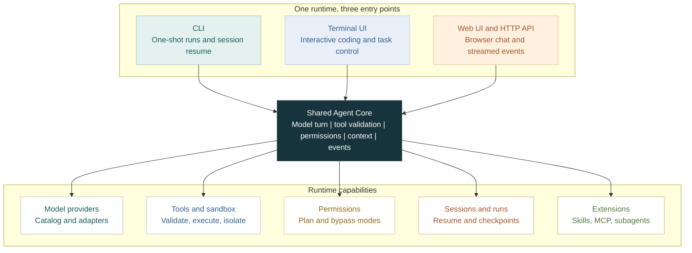
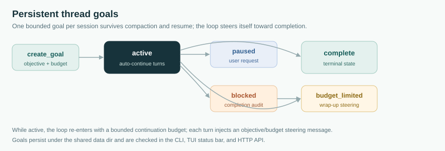
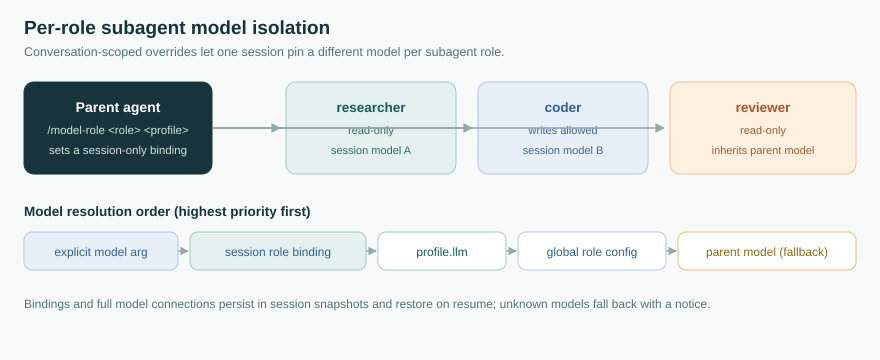
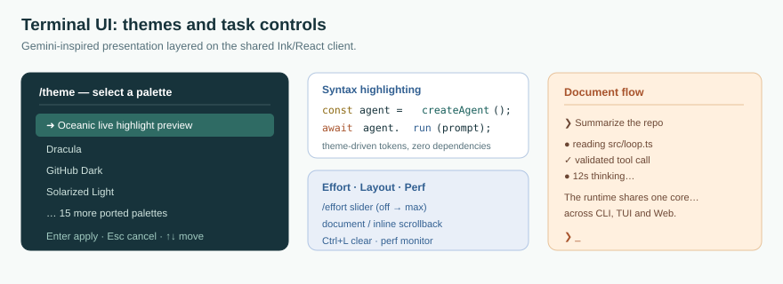

# Mini Agent Loop

[](https://www.npmjs.com/package/@krischen99999/mini-agent-loop)
[](https://nodejs.org/)

一个可扩展的 TypeScript 运行时，用于构建和运行编码智能体（coding agent）。你可以从交互式终端、一次性 CLI 或本地 Web UI 使用同一套智能体内核（agent core），并通过自己的模型、工具、技能（skills）和工作流进行扩展。

## 最近更新

最新版本聚焦于长时任务专注度、终端体验打磨以及按角色控制模型：

- **持久化线程目标（persistent thread goals）** —— 每个会话（session）一个有限目标，在上下文压缩（compaction）与恢复（resume）后仍然存在，具备自动继续推进的引导以及 CLI/TUI/Web 控制项。现已默认启用（设置 `MINI_AGENT_GOALS=0` 可退出）。
- **Gemini 风格主题与高亮** —— 首次运行主题对话框、19 套移植配色、`/theme` 命令、启动对话框策略，以及零依赖的、由主题驱动的代码块语法高亮。
- **更丰富的终端控制** —— Effort 滑块、行内/文档布局模式、性能监视器、尺寸变化刷新，以及 Ink TUI 中的 `Ctrl+L` 清屏。
- **按角色划分的子代理模型** —— 在一次对话中使用 `/model-role` 为不同子代理角色绑定不同模型，完整连接信息会持久化到会话快照并在恢复时还原。

详情参见[持久化线程目标](#持久化线程目标)、[终端 TUI](#终端-tui)和[配置](#配置)。

## 功能概览

| 能力 | 说明 |
|---|---|
| 多种运行方式 | Ink 终端 UI、可恢复的 CLI，以及带 HTTP/NDJSON API 的本地 Web 聊天界面。 |
| 可直接选择的模型 | 从 `/model` 浏览内置多提供商目录；配置提供商凭据后即可选择适配模型，无需自行定义端点。 |
| 编码工具 | 在工作区内读取、编辑、写入、搜索文件和运行命令，带参数校验与工作区边界检查。 |
| 可扩展工作流 | 技能（skills）、显式配置的 MCP 服务器、Git 操作、计划（plan）以及 Plan-Act 执行。 |
| 长时任务 | 持久化会话、后台任务、子代理（subagent）、检查点（checkpoint）与可恢复运行。 |
| 受控执行 | 用于只读分析的 plan 模式、用于写入的显式执行模式，以及可配置的沙箱适配器。 |

## 快速开始

需要 Node.js 22.19 或更高版本，以及受支持模型提供商的 API 密钥。例如，配置一个 OpenAI 兼容提供商并安装 CLI：

```bash
npm install --global @krischen99999/mini-agent-loop
export OPENAI_API_KEY=your-api-key
mini-agent-loop
```

如果要直接运行单个任务，而不是打开交互式终端：

```bash
mini-agent-loop-run "Summarize the project structure"
```

交互式终端默认以 `plan` 模式启动。当你希望允许写入及其他允许的操作时，用 `Shift+Tab` 切换到 `bypass`。实时模型调用仍需要提供商凭据。

本地开发：

```bash
npm install
npm run tui
```

## 工作原理

所有前端共用同一个智能体循环（agent loop）、工具注册表、权限管理器和会话存储：



工具参数会在执行前校验。工具失败会作为工具结果返回给模型，并且在下一次模型轮次之前，每次调用都会收到结果。

## 选择界面

| 界面 | 启动方式 | 适用场景 |
|---|---|---|
| Terminal UI | `mini-agent-loop` 或 `npm run tui` | 交互式编码、模型选择、会话和任务控制。 |
| CLI | `mini-agent-loop-run "..."` 或 `npm start -- "..."` | 一次性作业、脚本编写和恢复会话。 |
| Web UI | `mini-agent-loop-web` 或 `npm run web:start` | 浏览器聊天、工作区选择和流式工具活动。 |

Web UI 也可以在开发模式下运行：用 `npm run dev` 启动 API，用 `npm run web:dev` 启动前端。构建与启动选项参见 [Web UI](#web-ui)。

## 模型与扩展

内置目录包含来自多个提供商的适配模型。在 TUI 中使用 `/model` 搜索并选择。你只需提供该提供商的 API 密钥；私有网关可通过 Web 设置或 `MINI_AGENT_MODELS` 添加。模型选择与自定义网关设置参见[提供商与模型](#提供商与模型)。

运行时还支持技能（Skills）、显式配置的 MCP 服务器、本地工具、Git 工作流、外部仓库分析、视觉预处理和文档处理。参阅 [SDK 指南](docs/build-agent-guide.md)，在此运行时之上构建专用智能体。

## 文档

- [架构](docs/architecture.md) —— 运行时流程、模块图和 HTTP 路由。
- [安全模型](docs/security-model.md) —— 权限模式、沙箱与网络访问。
- [Web 运行策略](docs/web-run-policy.md) —— 预算、检查点与继续行为。
- [构建智能体](docs/build-agent-guide.md) —— 自定义工具、配置档案与委派。
- [项目分析](docs/project-analysis.md) —— 代码库结构与工程笔记。

**本篇目录：** [最近更新](#最近更新) · [快速开始](#快速开始) · [界面选择](#选择界面) · [模型](#模型与扩展) · [配置](#配置) · [CLI](#cli) · [Web UI](#web-ui) · [集成](#集成) · [终端 TUI](#终端-tui) · [开发](#开发)

## 配置

下面给出环境变量参考和提供商专属设置。多数设置为可选项；实际运行需要为所选提供商配置凭据。

### 环境变量

| 变量 | 必填 | 默认值 |
|---|---|---|
| `OPENAI_API_KEY` | 是\* | — |
| `DEEPSEEK_API_KEY` | 是\*（DeepSeek 替代方案） | — |
| `AGNES_API_KEY` | 否 | — |
| `GEMINI_API_KEY` | 否 | — |
| `DASHSCOPE_API_KEY` | 否 | — |
| `ZHIPU_API_KEY` | 否 | — |
| `MOONSHOT_API_KEY` | 否 | — |
| `XAI_API_KEY` | 否 | — |
| `MISTRAL_API_KEY` | 否 | — |
| `GROQ_API_KEY` | 否 | — |
| `OPENROUTER_API_KEY` | 否 | — |
| `TOKENROUTER_API_KEY` | 否 | — |
| `ORCAROUTER_API_KEY` | 否 | — |
| `SILICONFLOW_API_KEY` | 否 | — |
| `COHERE_API_KEY` | 否 | — |
| `PERPLEXITY_API_KEY` | 否 | — |
| `STEPFUN_API_KEY` | 否 | — |
| `OPENAI_BASE_URL` | 否 | 自动使用 OpenAI 或 DeepSeek |
| `OPENAI_MODEL` | 否 | `gpt-4o-mini` / `deepseek-chat` |
| `MINI_AGENT_REQUEST_TIMEOUT_MS` | 否 | `120000`（总请求时间；`0` 表示禁用） |
| `MINI_AGENT_FIRST_RESPONSE_TIMEOUT_MS` | 否 | 与请求超时相同 |
| `MINI_AGENT_STREAM_IDLE_TIMEOUT_MS` | 否 | 流开始后 `60000` |
| `MINI_AGENT_MODELS` | 否 | — |

| `VISION_API_KEY` | 否\* | — |
| `VISION_BASE_URL` | 否\* | — |
| `VISION_MODEL` | 否\* | — |
| `VISION_PROVIDER` | 否 | `openai-compatible` / `zhipu` |
| `ZHIPU_API_KEY` | 否\* | — |
| `VISION_RETRIES` | 否 | `1` |
| `VISION_RETRY_DELAY_MS` | 否 | `1000` |
| `VISION_FALLBACK_MODEL` | 否 | — |
| `EXTERNAL_CODEBASE_ENABLED` | 否 | `1` |
| `EXTERNAL_CODEBASE_FETCH_TIMEOUT_MS` | 否 | `60000` |
| `EXTERNAL_CODEBASE_MAX_FILE_BYTES` | 否 | `262144` |
| `EXTERNAL_CODEBASE_MAX_RESULT_BYTES` | 否 | `102400` |
| `EXTERNAL_CODEBASE_MAX_CACHE_BYTES` | 否 | `1073741824` |
| `EXTERNAL_CODEBASE_CACHE_TTL_HOURS` | 否 | `24` |
| `DEEPWIKI_ENABLED` | 否 | `0` |
| `DEEPWIKI_TIMEOUT_MS` | 否 | `30000` |
| `DEEPWIKI_MAX_RESULT_BYTES` | 否 | `102400` |
| `MINI_AGENT_MCP_CONFIG` | 否 | — |
| `MINI_AGENT_PERMISSION_MODE` | 否 | `plan`（或 `bypass`） |
| `MINI_AGENT_SUBAGENT` | 否 | CLI/server 中为 `1`，TUI 始终启用 |
| `MINI_AGENT_SEARCH_ORCHESTRATION` | 否 | `0`；设为 `1` 以暴露 `search_orchestrate` 工具 |
| `MINI_AGENT_BG_TASKS` | 否 | `1`；设为 `0`/`false` 可禁用 `bg_*` 工具 |
| `MINI_AGENT_BG_BACKEND` | 否 | `auto`；可选 `auto`、`tmux` 或 `process` |
| `MINI_AGENT_WEB_TOKEN_BUDGET` | 否 | 每次分配无限制 |
| `MINI_AGENT_WEB_TOOL_CALL_BUDGET` | 否 | 每次分配无限制 |
| `MINI_AGENT_WEB_WRITE_CALL_BUDGET` | 否 | 每次分配无限制 |
| `MINI_AGENT_WEB_DEADLINE_MS` | 否 | 每次分配的执行时间无限制 |
| `MINI_AGENT_WEB_MAX_COMPACTIONS` | 否 | `8` |
| `MINI_AGENT_WEB_SAME_ACTION_LIMIT` | 否 | `3` 次重复 |
| `MINI_AGENT_WEB_NO_PROGRESS_LIMIT` | 否 | `6` 轮 |
| `MINI_AGENT_WEB_EMERGENCY_ITERATION_CAP` | 否 | `2000`（安全兜底） |
| `MINI_AGENT_TUI_TOKEN_BUDGET` | 否 | 每次 TUI 运行无限制 |
| `MINI_AGENT_TUI_TOOL_CALL_BUDGET` | 否 | 每次 TUI 运行无限制 |
| `MINI_AGENT_TUI_WRITE_CALL_BUDGET` | 否 | 每次 TUI 运行无限制 |
| `MINI_AGENT_TUI_DEADLINE_MS` | 否 | 每次 TUI 运行的执行时间无限制 |
| `MINI_AGENT_TUI_MAX_COMPACTIONS` | 否 | `8` |
| `MINI_AGENT_TUI_SAME_ACTION_LIMIT` | 否 | `3` 次重复 |
| `MINI_AGENT_TUI_NO_PROGRESS_LIMIT` | 否 | `6` 轮 |
| `MINI_AGENT_TUI_EMERGENCY_ITERATION_CAP` | 否 | `2000`（安全兜底） |
| `MINI_AGENT_GLOBAL_TOKEN_BUDGET` | 否 | 无限制；父代理与嵌套子代理共享 |
| `MINI_AGENT_GLOBAL_CONCURRENCY_LIMIT` | 否 | 无限制；跨重叠批次生效 |
| `MINI_AGENT_GLOBAL_SUBAGENT_CALL_BUDGET` | 否 | 无限制；父代理与嵌套子代理共享 |
| `MINI_AGENT_AUTO_SUBAGENT` | 否 | 默认启用；设为 `0`/`false`/`off` 可禁用 |
| `MINI_AGENT_AUTO_SUBAGENT_MIN_SCORE` | 否 | `2` |
| `MINI_AGENT_AUTO_SUBAGENT_PROFILE` | 否 | 自动（`researcher`/`coder`/`reviewer`） |
| `MINI_AGENT_AUTO_SUBAGENT_MODEL` | 否 | 父代理模型 |
| `MINI_AGENT_AUTO_SUBAGENT_MAX_TURNS` | 否 | 配置档案/默认值 |
| `MINI_AGENT_AUTO_SUBAGENT_ALLOW_WRITES` | 否 | 禁用；自动预检保持只读 |
| `MINI_AGENT_SUBAGENT_AWAIT_BUDGET_MS` | 否 | `600000`；前台子代理在超过该等待预算后转入后台继续运行（设为 `0` 可禁用自动转后台） |
| `MINI_AGENT_GOALS` | 否 | 启用；设为 `0`/`false`/`no`/`off` 可禁用持久化线程目标（`get_goal` / `create_goal` / `update_goal` 工具） |
| `MINI_AGENT_GOAL_MAX_TOKEN_BUDGET` | 否 | 目标 token 预算无上限 |
| `MINI_AGENT_GOAL_MAX_CONTINUATIONS` | 否 | 每次用户提交最多 `50` 次自动目标续接 |

\* 为实际模型调用所选提供商配置密钥。模型选择器可以在提供商密钥尚未设置时显示目录条目。除非要配置单独的视觉模型，否则视觉相关变量均为可选项。

超时也可以通过模型目录（`MINI_AGENT_MODELS` 条目或内置目录条目）、持久化的配置档案或 `switchLlmModel` **按模型**配置。解析顺序：显式配置覆盖 → 模型目录值 → 环境变量 → 默认值。参见[单模型超时设置](#单模型超时设置)。

### 请求超时恢复

LLM 请求使用三个截止时间。首响应截止时间涵盖等待提供商开始响应的时间。流空闲截止时间在收到任何流数据块（包括推理输出）时重置。总请求截止时间限制整个请求，不受流活动影响。

如果请求在产生答案文本之前超时，主智能体会重试一次。在已有部分答案文本之后发生的超时会保留在对话历史中，不会自动重放。嵌套子代理超时会把恢复出的部分文本作为错误结果返回给父代理，由父代理决定重试还是简化任务。

### 持久化线程目标

CLI、TUI 和 Web 服务器默认启用目标功能。设置 `MINI_AGENT_GOALS=0` 可禁用。每个会话最多携带一个目标：具体目标内容、状态（`active`、`paused`、`blocked`、`usage_limited`、`budget_limited`、`complete`）、可选的 token 预算，以及累计的 token/时间用量。目标持久化在共享的 `AGENT_DATA_DIR` 下的 `goals/<session-id>.json`，并在会话恢复时还原。



- **模型工具**：`get_goal` 读取状态和剩余预算；`create_goal` 启动一个目标（存在未完成目标时会失败）；`update_goal` 仅在用户明确要求时才可把目标改为 `complete`、`blocked` 或 `paused`。
- **自动续接**：当目标保持 `active` 且循环本应停止时，运行时会以有限次数的目标续接轮次重新进入智能体循环。每次续接都会向模型上下文注入一条续接引导消息（目标、预算、完成与阻塞审计）。
- **token 预算**：当带预算的目标累计用量达到预算时，它会被标记为 `budget_limited`，并注入一条收尾引导消息，而不是开始新的实质性工作。
- **TUI**：`/goal` 查看目标；`/goal <objective> [--token-budget N]` 创建或编辑目标；`clear`、`pause`、`resume`、`complete` 控制其状态。状态栏显示精简的目标片段，目标状态变化以 `goal_updated` 循环事件流式传输。
- **HTTP**：`GET/PUT/DELETE /api/sessions/:id/goal` 对应 TUI 操作；`/api/config` 报告 `goals.enabled`。

目标内容始终被视为不可信的用户数据，绝不会作为对模型的指令。

### Web 任务策略与恢复

Web 任务默认使用 `AgentRunPolicy`。token 和时间预算、工具与写入调用预算、上下文压缩以及停滞动作检测共同决定何时暂停执行。默认的 `emergencyIterationCap: 2000` 是最终安全兜底，而不是常规任务预算。token、时间、工具和写入预算在配置之前均无限制；压缩默认 8 次，重复动作默认 3 次，无进展轮次默认 6 轮。

设置 `AgentServerOptions.runPolicy` 或 `MINI_AGENT_WEB_*` 环境变量可配置限额。编程式字段覆盖环境变量，环境变量覆盖默认值。值必须为正的安全整数；无效设置会导致初始化失败。预算在安全的轮次边界检查，因此进行中的请求或工具批次可能在暂停前超限。

策略暂停会保存完整的历史和用量，然后发出一个带 `budget_exhausted`、`safety_cap_reached`、`context_exhausted` 或 `stalled` 原因的 `run_stopped` 事件。Web UI 会显示暂停详情和消耗情况。刷新或重启会保留 `runState`，包括本次分配用量和会话累计用量。

Web 任务运行时，一行受 Codex 启发的工作活动行会显示当前工作、耗时和 Stop 控件。其标题等待 600 毫秒，然后每四秒扫过一秒的亮度高光。活动变化会重启扫光，但保留当前轮次的耗时。该视图遵循减少动效（reduced-motion）偏好。来源署名和上游 Apache-2.0 许可证见 `apps/web/THIRD_PARTY_NOTICES.md` 与 `apps/web/public/licenses/openai-codex/`。

Continue 按钮会从保存的检查点分配新的默认预算。`POST /api/sessions/:id/continue` 也接受新的限额，例如 `{ "tokenBudget": 50000, "deadlineMs": 300000 }`，或使用 `{ "budgetMode": "remaining" }` 复用保存的分配。停机时间不计入执行时间。剩余预算耗尽时立即暂停。

核心循环会持续运行，直到助手完成、调用方取消或运行策略发出停止事件。不存在默认的 80 轮停止。CLI 运行会从工具事件检测重复动作和持续无进展；TUI 和 Web 还会应用各自配置的预算和紧急安全上限。显式的 `maxTurns` 或 `MINI_AGENT_MAX_TURNS` 仍可作为兼容性安全上限。Web 配置、检查点字段和请求示例参见 [Web 策略与 API 事件](docs/web-run-policy.md)。

### 自动子代理预检

CLI、TUI 和 HTTP 服务器现在默认启用确定性的代码级预检。循环会用可解释的信号对第一条用户请求评分（多步骤语言、代码/工作区上下文、写入/审查意图、深范围、网络研究，以及显式的「delegate/subagent」措辞）。当评分达到 `MINI_AGENT_AUTO_SUBAGENT_MIN_SCORE`（默认 `2`）时，它会在父模型调用之前运行**一个**子代理，并把结果注入父代理上下文。

除非你覆盖配置，否则配置档案会自动选择：

- 写入/实现/重构 → 默认 `researcher`；`coder` 需要 `MINI_AGENT_AUTO_SUBAGENT_ALLOW_WRITES=1`
- 纯审查/审计 → `reviewer`
- 其他 → `researcher`

简单的单步骤提示（例如「读一下 package.json」）有意不做委派。当请求被委派时，父代理还会进入**协调器模式（coordinator mode）**：它会获得更强的编排提示词，并且只允许少量直接探索工具调用（`read`/`grep`/`find`/`ls`/`codebase_*`），更深入的工作必须通过 `subagent` / `subagent_batch` 进行。预检使用聚焦的子任务（而不是原始用户提示词的大段文本），当达到 `maxTurns` 或没有生成干净的最终总结时，返回可恢复的部分进展，而不是让整个委派硬失败。预检选项不会传播到嵌套子代理，因此不会递归。

内置的 `researcher` 和 `reviewer` 档案为只读，不能使用工作区写入、进程执行、网络访问或外部 MCP 数据。

`web-researcher` 是需要网络的问题的独立档案。它被授予 `web_search`、`fetch_content`、`get_search_content`、`source_check` 以及只读工作区工具，仅此而已。它刻意*没有*被标记为 `readOnly`，因为子代理只读门禁也会阻断网络访问，从而剥离它存在所要使用的网络工具；工具白名单才是边界。

设置 `MINI_AGENT_SEARCH_ORCHESTRATION=1` 可添加 `search_orchestrate` 工具。它会搜索网络，让 `web-researcher` 规划器把问题拆分为按依赖排序的任务列表，把这些任务作为子代理运行，然后综合出一个答案。每个任务可以绑定自己的模型 —— 任意目录 id 或 Web 设置页中保存的提供商模型 —— 因此不同子代理可以运行在不同的第三方网关上。该工作流把每次子代理调用都路由到宿主机自身的子代理工具，因此权限、token 预算、预处理器和 `/multi-agent` 角色绑定都原样适用。父代理和嵌套子代理可以通过 `MINI_AGENT_GLOBAL_TOKEN_BUDGET` 共享总 token 预算；`MINI_AGENT_GLOBAL_CONCURRENCY_LIMIT` 限制重叠的 `subagent_batch` 工作量。并发限制值为 `0` 表示无限制。

子代理预算是二维的，可以组合使用：除了上面的 token 预算，共享预算状态（`AgentRuntimeRef` 上的 `GlobalBudgetState`，或子代理工具和 `PipelineOrchestratorOptions` 的 `agentBudgetCalls` 选项）还携带一个**调用预算** —— 对所有深度、批次以及 worker/reviewer 派发的子代理启动总数的硬上限。面板在启动**前**校验：如果同步批次、异步批次提交或流水线波次需要超过剩余预算的调用数，则整体拒绝，避免任何子任务亏本地启动（Grok Build `agent_budget` 语义）。`dynamic` 批次分配策略还会在每个依赖波次开始时重新拆分剩余全局 token 预算，使后续波次继承前面波次节省的额度。提供商速率限制失败（429 / "rate limit"）会表现为 `rate_limit` 子代理错误，而不是笼统的 `api` 错误。

当内层循环因有界停止（安全上限或运行预算）而停下时，子代理会恢复其部分工具进展，并带 `[Partial]` 标记返回给父代理，而不是丢弃这些工作。

#### 按角色绑定模型



一次对话可以为每个子代理角色绑定不同模型。在 TUI 中，`/model-role <role> <profile>` 把一个已保存的模型档案绑定到 `researcher` 或 `coder` 这样的角色，仅本次会话有效；`/model-role <role> clear` 移除绑定。有效模型按以下顺序解析：显式 `model` 参数 → 对话角色绑定 → 档案模型 → 全局角色配置 → 父代理模型。绑定和完整模型连接会保存在会话快照中，因此恢复后仍然有效；不可用的模型会回退到当前模型并给出提示，而不会中断会话。

设置 `MINI_AGENT_AUTO_SUBAGENT=0` 可跳过预检，把委派交给模型：

```bash
export MINI_AGENT_AUTO_SUBAGENT=0
```

### 提供商与模型

#### OpenAI

```bash
export OPENAI_API_KEY=sk-...
# optional:
# export OPENAI_BASE_URL=https://api.openai.com/v1
# export OPENAI_MODEL=gpt-4o-mini
# export OPENAI_MODEL=openai/gpt-6-astra
# Codex ChatGPT backend (same model id, qualified reference required):
# export OPENAI_MODEL=openai-codex/gpt-6-astra
```

#### DeepSeek（中国本地开发推荐）

DeepSeek 的聊天 API 兼容 OpenAI，并通过 `deepseek-chat` 支持工具调用。

```bash
# simplest: only DeepSeek key (base URL + model auto-fill)
export DEEPSEEK_API_KEY=sk-...

# or explicit OpenAI-compatible vars:
export OPENAI_API_KEY=sk-...          # your DeepSeek key
export OPENAI_BASE_URL=https://api.deepseek.com/v1
export OPENAI_MODEL=deepseek-chat
```

**智能体外壳推荐做法：** 把密钥放在 `mini-agent/.env`（已被 gitignore）。CLI 会自动加载：

```bash
# mini-agent/.env
DEEPSEEK_API_KEY=sk-...
```

在 [https://platform.deepseek.com](https://platform.deepseek.com) 获取密钥。当前默认模型是 `deepseek-v4-flash`。

#### Agnes AI

Agnes AI 使用 OpenAI 兼容的 Chat Completions API。其稳定模型是 `agnes-2.0-flash`；`agnes-2.5-flash` 是预览模型，需要 Agnes 账号开通访问权限。

```bash
export AGNES_API_KEY=your-agnes-api-key
export OPENAI_MODEL=agnes-ai/agnes-2.0-flash

# To use the preview model when your key has been enabled:
# export OPENAI_MODEL=agnes-ai/agnes-2.5-flash
```

两个模型都支持流式输出、工具调用和图片 URL。其端点为 `https://apihub.agnes-ai.com/v1/chat/completions`；无需覆盖 base URL。当 `AGNES_API_KEY` 是唯一配置的提供商密钥时，默认选择为 `agnes-2.0-flash`。

#### Moonshot AI（Kimi K3）

Kimi K3 可通过 Moonshot 的 OpenAI 兼容区域端点使用，并沿用现有的 `MOONSHOT_API_KEY`：

```bash
export MOONSHOT_API_KEY=sk-...
export OPENAI_MODEL=moonshotai/kimi-k3       # international endpoint
# or: export OPENAI_MODEL=moonshotai-cn/kimi-k3  # China endpoint
```

在 TUI 中使用 `/model moonshotai/kimi-k3` 或 `/model moonshotai-cn/kimi-k3`。必须使用限定引用，因为两个区域暴露相同的 `kimi-k3` 模型 id。

#### TokenRouter（Kimi K3 免费）

TokenRouter 通过其 OpenAI 兼容的 Chat Completions 端点提供固定的免费 Kimi K3 路由：

```bash
export TOKENROUTER_API_KEY=tr_...
export OPENAI_MODEL=tokenrouter/kimi-k3-free
```

在 TUI 中用 `/model tokenrouter/kimi-k3-free` 选择。项目会向 `https://api.tokenrouter.io/v1/chat/completions` 发送固定模型 id `kimi-k3-free`。

#### OrcaRouter（免费模型）

OrcaRouter 是 OpenAI 兼容的 AI 网关；目录注册了它的免费路由（见 <https://www.orcarouter.ai/models?price=free>）：

```bash
export ORCAROUTER_API_KEY=sk-orca-...
export OPENAI_MODEL=orcarouter/deepseek/deepseek-v4-flash-free
```

在 TUI 中选择已注册的免费路由之一：

```bash
/model orcarouter/deepseek/deepseek-v4-flash-free   # DeepSeek V4 Flash free (1M context)
/model orcarouter/tencent/hy3-free                  # Tencent Hy3 free (256K context)
/model orcarouter/z-ai/glm-5.3-flash-free           # GLM 5.3 Flash free (1M context, text + image)
/model orcarouter/orcarouter/free                  # OrcaRouter's free adaptive router
```

请求发往 `https://api.orcarouter.ai/v1/chat/completions`。

#### 内置目录与自定义提供商

内置目录包含生成的多提供商模型定义。启动 TUI，然后用 `/model` 搜索所有适配模型：

```bash
npm run tui

# examples inside the TUI
/model
/model deepseek/deepseek-v4.1-flash
/model openai/gpt-6.1-terra
/model openai/gpt-6-astra
/model openai-codex/gpt-6-astra
/model google/gemini-4-argon
/model anthropic/claude-sonnet-5.5
/model google/gemini-2.5-pro
/model openrouter/anthropic/claude-sonnet-4
# positional custom gateway: model, base URL, api key
/model xai/grok-3 https://api.sparkcode.top/v1 sk-...
# flag form still works for a custom OpenAI-compatible gateway
/model openai/gpt-4.1 --base-url https://llm.example/v1 --api-key-env COMPANY_LLM_KEY
# Claude 中转站: most gateways speak Chat Completions, so a custom URL
# drops native Anthropic Messages. Force Messages only when the gateway
# actually implements /v1/messages.
/model anthropic/claude-sonnet-4-6 https://api.sparkcode.top/v1 sk-...
/model anthropic/claude-sonnet-4-6 https://gw.example/anthropic/v1 sk-... --protocol anthropic
```

即使未配置提供商凭据，模型也会显示。选择模型不会持久化密钥；下一次发送请求时提供商会校验凭据。`--api-key VALUE` 也支持临时内存覆盖，但推荐使用 `--api-key-env ENV_NAME`。

对于新模型或私有 OpenAI 兼容网关，无需修改源码即可添加：

```bash
CUSTOM_LLM_KEY=sk-...
MINI_AGENT_MODELS='[{"provider":"company","id":"company-model-v1","baseUrl":"https://llm.example/v1","apiKeyEnv":"CUSTOM_LLM_KEY","input":["text"],"tools":true,"contextWindow":128000}]'
```

`MINI_AGENT_MODELS` 是 JSON 数组。每个条目需要 `provider`、`id`、`baseUrl` 和 `apiKeyEnv`；可选字段为 `input`、`tools`、`contextWindow` 和 `api`（`"anthropic-messages"` 可让 Claude 在 `baseUrl` 为私有网关时仍使用原生 Messages）。

Web UI 无需编辑环境变量即可持久化同样的设置。打开 **Settings → Models → Custom model API**，选择 **Add provider**，输入提供商 ID、base URL、API 密钥、协议以及一个或多个模型 id。**Fetch models** 会读取提供商的 `/models` 端点并填充模型列表；也可以手动输入模型。支持的协议有 OpenAI Chat Completions、OpenAI Responses 和 Anthropic Messages。配置存储在 `MINI_AGENT_MODEL_CONFIG`（或 `~/.mini-agent/models.json`）中，权限仅限所有者；Web API 从不返回 API 密钥。请使用服务的 API base URL，不带 `/chat/completions`、`/responses` 或 `/messages`。OpenAI 协议会保留配置的前缀（服务需要时包含 `/v1`）。Anthropic 接受带或不带尾部 `/v1` 的 base URL。

对于自定义推理模型，勾选 **Enable thinking** 并选择 **Default thinking level**。常见设置会自动填充；DeepSeek 的 URL 和模型 id 使用 DeepSeek 的思考格式。在对话的 **Effort** 菜单中更改当前级别。

**Advanced thinking settings** 是可选配置。它保留现有的自定义映射，并允许非常规端点限制可接受的级别或重命名 API 值（例如 `max` → `ultra`）。Chat Completions 提供商可以覆盖 **Thinking format**，或针对只接受开关的端点禁用 **Send reasoning effort**。提供商级覆盖位于 **Advanced API settings** 下。请求预览使用与实时 Chat Completions 请求相同的序列化器。

`customProviders` 条目中对应的字段为：

```json
{
  "compat": { "thinkingFormat": "deepseek", "supportsReasoningEffort": true },
  "models": [{
    "id": "my-reasoner",
    "reasoningEfforts": { "off": null, "high": "high", "max": "ultra" },
    "defaultThinkingLevel": "high"
  }]
}
```

此示例假设网关接受 DeepSeek 风格的思考参数和 `high`/`ultra` effort。显式的 efforts 对象只暴露其声明的级别；未声明的级别不可用。`off: null` 使用所选协议的 Off 行为（对 DeepSeek 为 `thinking: {type: "disabled"}`）；字符串则为 OpenAI 或 OpenRouter 等格式提供显式的 Off 值。仅在端点支持时声明 Off。`reasoningEfforts: false` 会禁用该能力。现有的 `reasoning: true/false` 配置仍然支持。这里展示的 `compat` 字段适用于 Chat Completions；Responses 和 Anthropic 使用各自的协议适配器。在对话的模型菜单中选择 **Effort** 可更改当前会话。选择在重启后保留。更新后的自定义提供商设置在下一次操作时生效，会保留受支持的会话级别，并在旧级别被移除时回退到模型默认值。

还可以用 `MINI_AGENT_RELAY` 为所有 Claude 请求设置持久的中转站。对于常见的 Chat Completions 网关，省略 `protocol`（或设为 `"openai-compatible"`）；仅当中转站实现了 Anthropic `/v1/messages` 时才设置 `"protocol":"anthropic-messages"`：

```bash
MINI_AGENT_RELAY='{"providers":["anthropic"],"baseUrl":"https://api.sparkcode.top/v1","apiKey":"sk-..."}'
```

#### 单模型超时设置

慢速深度思考模型通常比快速聊天模型需要更长的截止时间。与其为所有模型提高全局超时，不如在模型条目上携带自己的分层超时：

```bash
CUSTOM_LLM_KEY=sk-...
MINI_AGENT_MODELS='[{"provider":"company","id":"deep-thinker-v1","baseUrl":"https://llm.example/v1","apiKeyEnv":"CUSTOM_LLM_KEY","contextWindow":128000,"timeoutMs":600000,"firstResponseTimeoutMs":300000,"streamIdleTimeoutMs":180000}]'
```

- `timeoutMs` —— 总请求截止时间（默认 120 秒；`0` 禁用）
- `firstResponseTimeoutMs` —— 首块响应时间（默认为 `timeoutMs`；`0` 禁用）
- `streamIdleTimeoutMs` —— 流数据块之间的最大间隔（默认 60 秒；`0` 禁用）

解析顺序：显式配置覆盖 → 模型目录值 → `MINI_AGENT_*_TIMEOUT_MS` 环境变量 → 默认值。用 `/model` 切换模型会自动采用目标模型的目录超时并丢弃过期值。这些字段也可以持久化到 `~/.mini-agent/models.json` 中的档案（见下文）。

#### DeepSeek 的视觉预处理

DeepSeek 仍是文本推理模型。单独的 OpenAI 兼容视觉模型会在调用 DeepSeek 之前把图片转换为结构化观察。该适配器与提供商无关。视觉变量是可选的；对于通用提供商，需要同时设置 `VISION_API_KEY`、`VISION_BASE_URL` 和 `VISION_MODEL`。配置后，发给纯文本主模型的图片会在主模型调用前先被分析。未配置时，沿用现有的 `IMAGE_POLICY` 降级行为。例如，兼容 DashScope 的 Qwen VL 配置可以放在 `.env` 中：

```bash
DEEPSEEK_API_KEY=sk-...
OPENAI_MODEL=deepseek-chat

VISION_API_KEY=sk-...
VISION_BASE_URL=https://dashscope.aliyuncs.com/compatible-mode/v1
VISION_MODEL=qwen-vl-plus
```

对于 Zhipu 的 OpenAI 兼容视觉端点，只需提供商密钥即可使用预设；如果你的账号提供不同的当前 GLM 视觉模型，可覆盖 `VISION_MODEL`：

```bash
DEEPSEEK_API_KEY=sk-...
OPENAI_MODEL=deepseek-chat
VISION_PROVIDER=zhipu
ZHIPU_API_KEY=...
# optional:
# VISION_MODEL=glm-4v-plus
```

```text
user/tool images
  -> VisionPreprocessor (all new images in one batch)
  -> structured vision analysis
  -> DeepSeek (text only)
```

如果视觉请求失败、60 秒后超时或返回空内容，本轮会在调用 DeepSeek 之前失败。临时的 429/5xx/网络错误默认重试一次。设置 `VISION_FALLBACK_MODEL` 可在这些重试后尝试另一个视觉模型；回退是显式启用的，以避免意外的 API 用量。

## CLI

在 `package.json` 所在的仓库根目录运行以下命令：

```bash
# offline unit tests (no key)
npm test
npm run typecheck

# live agent (needs API key in .env or export)
npm start -- "Summarize the project structure"
npm start -- "Describe this image" --image ./shot.png

# resume the most recent session in the current workspace
npm start -- --continue "Continue the previous task"

# resume a specific session, or list sessions when no id is supplied
npm start -- --resume <session-id> "Continue this session"
npm start -- --resume

# resume into a new fork without changing the source session
npm start -- --resume <session-id> --fork-session "Start a new branch here"

# persistent thread goal (enabled by default; MINI_AGENT_GOALS=0 disables)
npm start -- --goal "finish the migration" "then run the tests"
npm start -- --goal "finish the migration" --goal-token-budget 50000 "then run the tests"
npm start -- --goal clear "inspect current state"
npm start -- --goal-status "Show the current goal"

# equivalent without npm script:
npx tsx src/cli.ts "读取 package.json 并总结项目名"
```

**不要**在脚本名后带空格写成 `npm start `，并把 `--` 保留在提示词之前，以便 npm 把参数转发给 CLI。

事件（`assistant` / `tool_start` / `tool_end` / `done`）记录到 stderr；最终助手文本输出到 stdout。

## Web UI

GUI 把模型凭据和文件工具保留在本地 Node 服务器中。浏览器只接收经过净化的文本/工具事件，不会从智能体历史记录中收到 API 密钥或图片 base64。

```bash
# development: API on 127.0.0.1:3001, GUI on 127.0.0.1:5173
npm run dev

# production build, then serve GUI + API together on 127.0.0.1:3001
npm run build
npm run serve

# packaged Web entry: starts the local API and opens the bundled Web UI
npm run build:package
node dist/web-launcher.js

# after installing the package globally, the same entry is:
mini-agent-loop-web --workspace /absolute/path/to/project
```

Web 启动器是一个额外的入口点。它不会取代现有的 `mini-agent-loop` Ink 客户端或 `mini-agent-loop-run` 一次性 CLI。用 `--no-open` 保持浏览器关闭，或用 `--port <number>` 选择其他本地端口。`--workspace <path>` 为新建会话设置默认项目目录；单个会话仍可使用 Web 工作区选择器。

可选的服务器环境变量：

```bash
PORT=3001
AGENT_WORKSPACE=/absolute/path/to/workspace
```

聊天支持多轮会话、工作区文件树路径引用、每条消息最多五张图片、文件选择或剪贴板图片粘贴、工具活动事件、Markdown 渲染以及新会话重置。在侧边栏选择文件只会添加路径引用；智能体仍使用 `read` 工具加载内容。会话持久化在 `AGENT_DATA_DIR` 下（按工作区隔离，默认 TTL 为 30 天），服务器重启后恢复。

CLI、TUI 和 Web 服务器都会暴露 `bg_start`、`bg_status`、`bg_logs`、`bg_send`、`bg_wait`、`bg_kill`、`bg_snapshot`、`bg_replay`、`bg_search_logs`、`bg_kill_by_tag` 和 `bg_status_by_tag`，用于持久化后台任务。默认 `auto` 后端在安装了 tmux 时使用 tmux，否则运行一个脱离终端的 Node 进程。由进程支撑的任务支持日志、状态、等待、超时和取消；交互式 `bg_send` 需要 tmux。Web 服务器还提供按工作区隔离的 `/api/background-tasks` 控制路由，并在第一次后台任务请求时初始化该套件。设置 `MINI_AGENT_BG_TASKS=0` 可禁用。

启用后台任务且 Bash 未使用隔离沙箱时，`bash` 工具还接受 `is_background: true`，用于启动命令并立即返回其任务 ID。由此产生的任务由同样的 `bg_status`、`bg_logs`、`bg_wait` 和 `bg_kill` 工具管理。不带该标志则在前台运行命令。超过默认 15 秒等待预算的前台 Bash 命令会自动作为后台任务返回。在 TUI 中，`Ctrl+G` 会把当前等待的命令转入后台，同时保持当前轮次运行；在等待期间按 Enter 提交消息会立即把命令转入后台并发送消息。当 `bg_wait` 或子代理正在等待且没有更早排队的消息时，Enter 也会立即发送。在其他忙碌阶段，Enter 会把消息排队；空输入时再次按 Enter 会发送下一条排队消息，`Ctrl+Enter` 会取消当前轮次并发送草稿。设置 `MINI_AGENT_BG_FOREGROUND_MS` 可更改等待预算（`0` 表示一直等到 Bash 的 `timeout` 值）。后台完成会在 TUI 中显示输出的最后 4 kB，并把未被消费的完成结果发送给智能体；已经被工具等待的任务不会触发重复的智能体轮次。

TUI、CLI 和持久化服务器会话中的子代理调用默认在后台启动，并返回 `sub_...` 任务 ID。CLI 任务运行在脱离终端的 worker 进程中，因此在一次性父命令退出后仍会继续。用 `subagent_tasks` 列出任务，用 `subagent_output` 读取状态和输出，用 `subagent_wait` 等待一个或多个任务，用 `subagent_send` 为下一个模型轮次追加指令，用 `subagent_kill` 取消正在运行的工作。在 CLI 中，`subagent_batch` 默认也在脱离终端的 worker 中运行并返回 `jobId`；用它的 `status`、`result` 和 `wait` 动作管理持久化的 DAG。当调用方需要在同一次工具调用中获得批次结果时，指定 `mode: "sync"`。当调用方需要在同一次工具调用中获取结果时，设置 `runInBackground: false`。超过 `MINI_AGENT_SUBAGENT_AWAIT_BUDGET_MS` 的前台调用会转入后台继续，而不是无限期阻塞父代理。完成的转录保存在 `.subagent-tasks/` 下，可以用 `resumeFrom` 加新的任务提示词继续。如果 worker 意外退出，其任务会被记录为已中断，并在下次针对该会话调用 CLI 时从保存的检查点重启。脱离终端的批次作业在其所属会话再次打开时也会恢复。运行 `mini-agent-loop-run --continue` 或 `--resume <session-id>` 会在下一轮把未被消费的完成结果作为不可信的系统提醒送达。

未被消费的后台子代理完成结果会唤醒其所属的 TUI 或 HTTP 会话一次。服务器会在当前会话操作释放执行租约后排队一个新的会话作业。如果结果已被读取或等待、任务已被终止、`MINI_AGENT_AUTO_WAKE` 被禁用，或 Plan-Act 执行正在进行，则不会唤醒。设置 `MINI_AGENT_AUTO_WAKE=0` 可禁用完成唤醒。

HTTP API 接受 `workspaceId` 或 `sessionId` 来选择工作区。其路由为 `GET/POST /api/background-tasks`、`GET /api/background-tasks/:taskId`、`GET /api/background-tasks/:taskId/logs?offset=0&limitBytes=16384`、带 `{ "taskIds": ["bg_..."] }` 的 `POST /api/background-tasks/wait`、带 `{ "text": "...", "enter": true }` 的 `POST /api/background-tasks/:taskId/input`，以及带 `{ "force": true }` 的 `POST /api/background-tasks/:taskId/kill`。用 `{ "sessionId": "<session-id>", "command": "npm test", "name": "tests", "cwd": "." }` 启动任务；响应为 `202`，带新任务摘要。变更类路由需要会话，以便服务器应用该会话的权限模式。任务工作目录在受理前会根据所选工作区检查。

核心工具注册表沿用 Pi Agent 的七工具词汇：

- `read`：读取文本文件和受支持的图片。
- `bash`：在工作区中执行命令，支持超时和取消。
- `edit`：使用 `path` 和 `edits[]` 执行精确的唯一替换。
- `write`：创建或覆盖 UTF-8 文本文件。
- `grep`：正则表达式/字面量内容搜索，支持 glob、大小写和上下文选项。
- `find`：按 glob 模式查找文件。
- `ls`：列出目录内容，包括点文件。

默认启用集合是 Pi 的 `read`、`bash`、`edit` 和 `write`。CLI 用户可用 `--tools grep,find,ls` 选择加入只读工具，或用 `--exclude-tools bash` 移除工具。SDK/服务器调用方可以把等效选择传给 `createDefaultTools`。

外部公开 GitHub 分析默认增加四个工具：

- `codebase_open`：为 `owner/repo` 或 GitHub URL 创建一个只读句柄。
- `codebase_search`：在固定的 Git 修订版本上搜索，并给出文件和行号证据。
- `codebase_read`：从固定修订版本读取有限范围的源码。
- `codebase_explain`：可选的 DeepWiki 语义结构、内容和问答操作。

外部仓库是 `~/.mini-agent/codebases` 下的浅克隆裸仓库。智能体从不出库执行其代码。该路径下 Git 认证、全局 Git 配置、钩子和 LFS smudge 均被禁用。设置 `EXTERNAL_CODEBASE_ENABLED=0` 可移除这些工具。DeepWiki 默认禁用。设置 `DEEPWIKI_ENABLED=1` 可启用固定官方端点 `https://mcp.deepwiki.com/mcp`；仅公开仓库名和所提问题会被发送到该端点。

所有工具仍使用相对路径，并拒绝逃逸配置工作区或通过外部符号链接解析的路径。`.git` 和 `node_modules` 仍受工作区沙箱保护。

## 集成

### Windows 上的 Shell 执行

该工具保留名称 `bash`，但在 Windows 本地执行时会先查找 PowerShell 7（`pwsh.exe`），然后查找 Windows PowerShell（`powershell.exe`），最后回退到 `ComSpec` / `cmd.exe`。查找会检查绝对 PATH 条目和标准安装目录。PowerShell 在不加载配置文件且非交互的模式下运行。工具描述会声明所选 shell 的语法；命令不会在 bash、PowerShell 和 cmd 之间翻译。Unix 执行仍是 `bash -lc`。

沙箱类型为 `auto` 时，Windows 使用 Node 进程运行器，而不是隐式选择 Docker。`MINI_AGENT_SANDBOX_TYPE=docker` 会显式选择容器运行器，它仍执行 Linux bash，并要求可用的 Docker 运行时和沙箱镜像。其他平台保留原有的自动选择顺序。`required` 沙箱配置绝不回退到 Node：Windows 自动模式会失败，并提示显式配置 Docker。

**Node 运行器不是操作系统安全沙箱。** 它不强制任意 shell 文件系统隔离或可靠的网络隔离。权限检查仍然生效；仅对可信命令使用本地执行。本次改动未实现原生 Windows ACL 沙箱和交互式 PTY 会话。

### MCP 工具

智能体可以通过 `stdio` 或 Streamable HTTP（`"transport": "http"`，带 `url` 和可选 `headers`）从显式配置的 MCP 服务器加载工具。它不会自动发现项目配置，因为 MCP stdio 条目可以执行本地命令。请将 `MINI_AGENT_MCP_CONFIG` 指向你信任的文件：

```json
{
  "mcpServers": {
    "local-search": {
      "transport": "stdio",
      "command": "node",
      "args": ["/absolute/path/to/server.mjs"],
      "env": {
        "TOKEN": "${MCP_SEARCH_TOKEN}"
      },
      "required": false,
      "includeTools": ["search"],
      "timeoutMs": 30000,
      "reconnect": true,
      "reconnectDelayMs": 1000,
      "maxReconnectDelayMs": 30000,
      "maxTools": 16,
      "maxSchemaBytes": 262144,
      "maxResultBytes": 1048576
    }
  }
}
```

相对 `cwd` 值从配置文件所在目录解析。`${NAME}` 环境变量引用必须在智能体启动时存在。可选服务器不可用时会进入重连或错误状态；但 `required: true` 的失败服务器仍会阻止初次启动。也支持 `excludeTools`、`enabled` 以及按服务器设置的限额。已连接后退出的服务器会从活动工具注册表中移除，并默认以有界指数退避重连。把 `reconnect` 设为 `false` 可禁用该行为，或调整 `reconnectDelayMs` 和 `maxReconnectDelayMs`。

```bash
export MINI_AGENT_MCP_CONFIG=/absolute/path/to/mcp.json

# The one-shot CLI registers configured MCP tools on every invocation.
# Calls stay denied until this process opts in, either for every server or
# for one server / one tool. MINI_AGENT_MCP_ALLOW accepts the same entries.
npm start -- --allow-mcp-tools "使用已配置的远端工具查询数据"
npm start -- --allow-mcp search --allow-mcp docs/read "只允许这些远端调用"
```

所有客户端共用同一套 `PermissionManager` 策略。在 `bypass` 下，已配置的 MCP 工具无需批准提示即可运行。在 `plan` 下，写入、危险 shell 和 MCP 调用会被硬性拒绝，因为 plan 模式仅用于分析（远程工具元数据无法证明其本地只读行为）。`/api/config` 只返回经净化的服务器状态元数据，绝不返回命令、参数或环境变量值。

当服务器通告并发送 `tools/list_changed` 时，智能体会刷新完整的分页目录。下一个内层模型轮次会收到更新后的工具集，无需重启进程。MCP JSON 配置本身的更改仍需重启。

用户配置的服务器使用 stdio 或 Streamable HTTP。DeepWiki 内部使用固定的官方 Streamable HTTP 端点。已连接的服务器还会暴露 `mcp_prompts` 和 `mcp_resource`，用于列出和读取远程提示词与资源，并将其视为不可信数据。OAuth、sampling、elicitation 和 task-required 工具仍不在支持范围内。配置服务器后，TUI 状态行会显示类似 `MCP 2 ready` 的精简连接摘要。

### HTTP API

本地服务器暴露以下会话与工作流路由：

```text
GET    /api/health
GET    /api/config
GET    /api/workspace/list?path=   lazy directory listing (workspace sandbox)
POST   /api/sessions
GET    /api/sessions/:id
GET    /api/sessions/:id/permission-mode
PUT    /api/sessions/:id/permission-mode  { mode: plan|bypass }
POST   /api/sessions/:id/permissions/:requestId  { decision: allow|deny }
DELETE /api/sessions/:id
POST   /api/sessions/:id/messages  multipart(prompt, referencedPaths, images) -> NDJSON stream
POST   /api/sessions/:id/fork     { messageId? | messageIndex? } -> new session
POST   /api/sessions/:id/rewind   { messageId? | messageIndex } -> truncated session
GET    /api/sessions/tree         session fork tree
GET    /api/sessions/:id/goal     { goal } (403 when goals are disabled)
PUT    /api/sessions/:id/goal     { objective?, status?, tokenBudget?, clear? }
DELETE /api/sessions/:id/goal     { ok: true }
```

会话详情消息包含稳定的 `id` 值。`messageId` 保留所选消息及其之前的所有内容；`messageIndex` 仍为使用原始基于计数 API 的客户端保留。截断绝不会留下不完整的助手工具调用块。

#### 会话计划工作流

计划存储在 `dataDir/session-plans/:id`。

```text
GET    /api/sessions/:id/plan
POST   /api/sessions/:id/plan                 { prompt, plan, autoApprove? }
POST   /api/sessions/:id/plan/approve         { by? }
POST   /api/sessions/:id/plan/reject
POST   /api/sessions/:id/plan/edit            { plan }
POST   /api/sessions/:id/plan/archive
GET    /api/sessions/:id/plan/history
POST   /api/sessions/:id/plan/generate        { prompt } -> { plan, answer }
POST   /api/sessions/:id/plan/execute         { yes?, force? } -> NDJSON stream
POST   /api/sessions/:id/plan/retry           { yes?, force? } -> NDJSON stream
```

计划执行/重试会流式输出常规的智能体 NDJSON 事件，另外还包括：`plan_execution_started`、`plan_updated` 和 `plan_execution_finished`。存在计划时，会话详情（`GET /api/sessions/:id`）包含 `planStatus`。

## 终端 TUI

Ink 终端客户端与 CLI 和 Web GUI 使用同一个 Agent Core 和工具注册表。它支持流式输出、工具活动、文件补全和本地 `/model` 选择器。权限模式用 `Shift+Tab` 循环切换：

| 模式 | 是否执行工具？ | 是否询问用户？ | 典型用途 |
| --- | --- | --- | --- |
| `plan`（默认） | 仅本地只读；写入/危险 shell/MCP 硬性拒绝 | 无批准路径 | 风险分析 / 规划 |
| `bypass` | 是，包括 MCP | 从不 | 可信本地运行 / CI |

原有的 `approval` 权限模式已移除。不能静默映射到 `bypass`；安全分析请使用 `plan`，或在完整计划执行前使用计划工作流进行审查。

```bash
npm run tui
```

`npm run tui` 与安装后的 `mini-agent-loop` / `mini-agent-loop-tui` 命令运行同一个 **React + Ink** 终端 UI（`src/tui/ink-main.tsx`，打包为 `dist/tui.js`）。它采用受 Claude Code 启发的布局，但是本项目自己的客户端，并非 Anthropic 的 `claude` CLI。不存在 pi-tui、旧版或独立 ANSI 终端入口，也没有 `--renderer` 开关。Ink 客户端使用共享的 Agent Core、reducer、工具注册表、权限和会话持久化。



近期终端新增功能包括：首次运行的 `/theme` 对话框（19 套移植配色和实时高亮预览）、主题驱动的 fenced code 语法高亮（零依赖）、Effort 滑块（`/effort`）、行内和文档式滚动回溯布局、性能监视器、尺寸变化刷新以及 `Ctrl+L` 清屏。启动对话框策略由 `MINI_AGENT_THEME_PROMPT`（`always` / `first-run` / `never`）控制；所选配色和 effort 级别在重启后保留。

在 TUI 中使用 `/model`、`/profiles`、`/sessions`、`/resume [id]`（或 `resume [id]`）、`/clear`、`/quit` 或 `Ctrl+C`。输入 `/sessions` 或 `/resume` 会打开保存会话选择器，显示 ID、消息数和提示词预览。在 `/resume` 上按 Enter 恢复所选会话；`/resume <id-prefix>` 直接选择特定会话。用 `/mcp` 查看已配置 MCP 服务器状态，用 `/mcp <server>` 列出该服务器可用工具。启动标志与 CLI 一致：`npm run tui -- --continue`、`npm run tui -- --resume <id>` 和 `npm run tui -- --resume <id> --fork-session`。`/model` 也接受 `--base-url`、`--api-key-env` 和临时 `--api-key` 覆盖。会话持久化在共享的 `AGENT_DATA_DIR` 根目录下，下次启动时恢复历史、工具结果、Todo/Plan 状态、权限模式和模型设置。Ink 界面遵循 Claude Code 风格的对话布局。

全屏记录（transcript）保留完整对话并滚动显示全部内容，不会丢弃较早的消息。`↑/↓` 滚动几行，`PgUp`/`PgDn` 滚动一页，`Ctrl+↑/↓` 滚动一行，鼠标滚轮滚动，`Ctrl+G` 回到最新消息。在多行草稿中，`↑/↓` 先移动文本光标，到达第一行或最后一行后才滚动记录。

TUI 运行默认使用 `AgentRunPolicy`。token、时间、工具和写入预算、上下文压缩、重复动作检测以及无进展检测都可以在保留部分历史的前提下暂停运行。任务摘要会报告暂停原因和用量；`/continue` 会使用新的策略分配恢复保存的任务，而不添加合成的用户消息。设置 `MINI_AGENT_TUI_*` 变量可配置默认值。`MINI_AGENT_MAX_TURNS` 或显式 `maxTurns` 让调用方选择兼容性的硬停止路径。TUI 支持计划工作流斜杠命令：`/plan`、`/plan-show`、`/plan-approve`、`/plan-reject`、`/plan-run`、`/plan-retry`、`/plan-history`、`/plan-archive`。

终端输入遵循 Claude Code 风格的优先级顺序：`Tab`/`↑↓` 优先操作当前激活的命令、参数、文件、模型或档案选择器；没有选择器打开时，`Ctrl+P`/`Ctrl+N`（或 `Cmd+P`/`Cmd+N`）在保留当前草稿的前提下调出更早或更近的已提交提示词。`↑`/`↓` 保留给记录滚动，但多行草稿会先移动文本光标。`Alt+↑`/`Alt+↓` 在推理消息之间移动焦点，`Alt+T` 展开或折叠当前聚焦的推理块。

`/tasks`、`/copy`、`/skills` 和 `/resume` 提供参数补全；`/resume` 从共享会话存储加载会话 ID。

`skills/adapt-foreign-session` 可以把本地 Claude Code 或 Codex CLI 聊天以简短交接继续。用 `/skill adapt-foreign-session` 或 `MINI_AGENT_SKILLS=adapt-foreign-session` 激活，然后请求继续该会话。不使用技能也能调用同一个读取器：

```bash
npm start -- --resume-claude
npm start -- --resume-claude <session-id-or-title> "continue the imported work"
npm start -- --resume-codex latest
```

在 TUI 中，`/resume-claude [ref]` 和 `/resume-codex [ref]` 会把转录导入新的本地会话。Web 侧边栏也有相同操作。`/resume` 仍然只打开本项目保存的会话。重复导入同一个来源会话会重新打开已有的本地会话。读取器会检查主机上的 `~/.claude` 或 `~/.codex`；看不到该主目录的 Docker 沙箱没有可导入的转录。

CLI 一次性运行接受 `--mode plan|bypass`（默认 `plan`）。原有的 `approval` 权限模式不再支持；只读运行迁移到 `plan`，可信无人值守运行迁移到 `bypass`，或者使用下面的计划工作流在写入前人工审查。`--plan` 强制 plan 模式；`--plan-execute` 加载保存的计划并在 `bypass` 下执行。可能写文件的无人值守执行请使用 `--mode=bypass`。

### 计划工作流

计划存储在 `.mini-agent/plan/`（当前计划 + 历史归档）。

| 标志 | 操作 |
|------|--------|
| `--plan` | 仅生成计划（不写入） |
| `--plan --yes` | 生成并自动批准 |
| `--plan-show` | 显示当前计划（元数据 + 预览） |
| `--plan-approve` / `--plan-reject` | 批准或拒绝当前计划 |
| `--plan-execute` / `--plan-retry` | 执行 / 重试已保存的计划 |
| `--plan-force` | 即使被拒绝/待处理也强制执行 |
| `--plan-edit` | 在当前计划 markdown 上打开 `$EDITOR` / `$VISUAL` / `vi` |
| `--plan-set-file <path>` | 从文件替换当前计划 markdown |
| `--plan-history` | 列出归档计划 |
| `--plan-archive` | 把当前计划快照存入历史 |

执行后，工作流会运行**文件审计**（可用时使用 git status/diff）：计划文件与实际更改文件、计划外编辑，以及推断的每步状态（`todo` / `doing` / `done` / `failed`）。审计保存在计划文档上，并由 CLI / TUI / 服务器事件打印。

成功的 `--plan-execute` 运行会自动把完成副本归档到 `.mini-agent/plan/history/<id>.json`（当前计划保留在原处）。

思考强度与模型选择分开配置。在 TUI 中，按 `Ctrl+R` 循环切换当前模型支持的所有级别；状态栏会立即显示新级别。需要逐级精确调整时使用 `Shift+Up` / `Shift+Down`（或 `Alt+.` / `Alt+,`）。`/model` 仍负责更换模型，这些快捷键只更改当前会话配置，从不改写用户提示词。该设置与提供商无关：不会自动切换提供商或模型。循环只包含已映射的提供商级别，因此对声明了 `xhigh` 的模型（例如 GPT-5.2+ 和 Claude Opus 4.7+）会显示 `xhigh`，否则省略。对具备推理能力的模型默认为 `medium`，其他模型默认为 `off`；`DEFAULT_THINKING_INTENSITY=low|med|high|xhigh|ultra` 会覆盖启动默认值。档案可以持久化可选的 `thinkingLevel`，以及在该档案激活时应用的可选单模型超时覆盖（`timeoutMs`、`firstResponseTimeoutMs`、`streamIdleTimeoutMs`）。

## 开发

### 测试

使用 Node 内置测试运行器 + 脚本化的假模型（无需 API 密钥）：

```bash
npm test
```

覆盖范围包括：

- 正常路径：用户 → 助手(toolCalls) → 工具 → 助手(text)
- 工具调用 id ↔ 工具结果配对
- 未知工具 → `isError` 工具消息（不崩溃）
- 校验失败 → `isError` 工具消息（不崩溃）
- 事件驱动的循环完成、策略停止、预算持久化和 Continue 分配
- `read` 沙箱 / 文件不存在行为
- 符号链接逃逸拒绝
- 有视觉/无视觉消息准备
- 按提供商选择 API 密钥
- 可插拔消息预处理
- 纯文本模型调用前的批量视觉分析
- 视觉失败可防止不支持的模型瞎猜
- 权限模式（`plan` / `bypass`）

### 项目结构

完整目录图、前端/运行时边界和 HTTP 路由模块拆分参见 [`docs/architecture.md`](docs/architecture.md)。

```text
mini-agent-loop/
  scripts/generate-models.ts   # generates the provider model catalogs
  src/
    loop.ts                    # core agent turn/loop
    cli.ts  server.ts          # CLI and HTTP entry points
    server/routes/             # HTTP routes split by domain
    tui/                       # single Ink/React terminal client
    llm/  pi-ai/               # model calls and the vendored provider layer
    tools/  runtime/           # built-in tools and the execution broker
    permissions.ts             # permission modes and approval requests
    skills/  mcp/  subagent/   # extension surfaces
    plan/  plan-act/           # plan document kernel and phase state machine
    orchestration/  sandbox/   # background jobs and shell isolation
  test/                        # ~100 node:test suites
  docs/                        # architecture, security model, design notes
```

### 运行时不变量

1. 执行前校验工具参数
2. 工具失败是**消息**（`isError`），而不是循环崩溃
3. 每次工具调用在下一次 LLM 调用前都会收到工具结果
4. 助手没有工具调用时循环停止
5. 运行因助手的终止响应、取消或策略停止事件而结束

`maxTurns` 和 `MINI_AGENT_MAX_TURNS` 是可选的兼容性安全上限。策略停止会发出带停止原因的 `run_stopped` 并保留部分历史；正常完成由助手不再返回工具调用驱动。

### 部署说明

部署前，请为目标环境配置提供商、持久化、可观测性和安全性。验证沙箱可用性、网络策略、真实提供商行为以及长时作业恢复；离线测试不覆盖这些与部署相关的条件。
